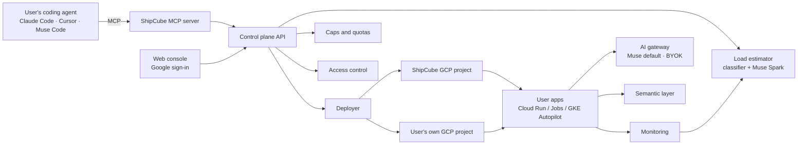

# ShipCube

**The infrastructure layer for apps you build with your coding agent.**

You build an internal app (a tracker, dashboard, report, API or scoring job) in Claude Code, Cursor, Muse Code or any other MCP-capable coding agent. Your agent connects to ShipCube's MCP server, and ShipCube handles the infrastructure:

- **Load estimation:** predicts how the app will behave (batch, bursty, steady, memory-heavy, I/O-bound) and sizes it.
- **Caps:** spend, rate and resource limits for each app, so nothing runs away.
- **Deployment on GCP:** Cloud Run services, Cloud Run jobs or GKE Autopilot, chosen from the load estimate. It runs on ShipCube's GCP project or on **your own GCP project and credits**, linked with Google sign-in.
- **Access control:** only the owner and the people they allow can open an app.
- **Data:** a minimal typed semantic layer, so apps run on any customer set without code changes.
- **AI for your apps:** apps that need a model get one through ShipCube's AI gateway. Muse is the default; you can also bring your own key.
- **Continuous monitoring:** health, data freshness, cost and drift, with suggestions to move an app when it outgrows its tier.

Built for the Meta Global AI Developer Hackathon (Indie track) on Meta's Muse models.

**Demo video (2:31):** [youtu.be/KhK0FmqYF1g](https://youtu.be/KhK0FmqYF1g)

2 minutes? Watch the video. 20 minutes? Run it locally (below).

## Where Muse decides

ShipCube uses Meta's **Muse Spark** (`muse-spark-1.3`, through the Meta Model API) in three places:

1. **Explaining each load estimate.** The sandbox measures the app, and the classifier picks the workload class, tier and price. Muse Spark turns those measurements into the reasoning the user reads, writes the trade-off for each alternative tier, and recommends the app's caps. `deploy_app` doesn't apply them by itself: the user or agent sets them with `set_caps`.
2. **Drafting data-model changes.** `data_propose_migration` takes a plain-English request or the app's code, and Muse Spark drafts the change. A person approves it before it applies.
3. **The model inside every deployed app.** Apps call Muse through ShipCube's AI gateway by default, with a token budget for each app.

   Muse output via the ShipCube gateway (provider: meta), captured on the local stack on 2 Nov 2026. The prompt was a one-word classification of an order note. The reply is trimmed below. The same call without the app token got a 401.

   ```
   HTTP/1.1 200 OK
   X-Shipcube-Model: muse-spark-1.3
   X-Shipcube-Provider: meta

   {"model":"muse-spark-1.3","choices":[{"message":{"role":"assistant","content":"delivery"},"finish_reason":"stop"}],"usage":{"prompt_tokens":32,"completion_tokens":367,"total_tokens":399,"completion_tokens_details":{"reasoning_tokens":357}}}
   ```

Two real estimates from the local stack, as Muse returned them (`explained_by: muse-spark-1.3`):

> **order-tracker** (dashboard, 25 office-hours users): "Classifier gives bursty_interactive at 86.9% vs 10% steady. Measured run shows low average 0.04 vCPU with p95 0.27 vCPU, 6.7 ms mean latency, and 42 MB peak well under 512Mi. Zero network calls and 25 expected office-hours users fit scale-to-zero T1 with 1 vCPU, max 2 instances, 80 concurrency at $0.81/month expected."
>
> `recommended_caps: {"cpu": "1", "memory": "512Mi", "max_instances": 2, "concurrency": 80, "requests_per_minute": 150, "monthly_spend_usd": 5.0, "timeout_s": 60}`

> **A second Flask app, 12 users:** "Classifier picked bursty_interactive at 65% over batch_cron at 30% for this 2-route Flask app with 12 expected users. … T1 with 0.5 vCPU, 512 MiB, scale-to-zero and max 2 instances covers this at $0.22/month expected ($0.09-$0.60), versus T3 at $26.32/month."

Guardrails on what Muse can change (`packages/placement/src/shipcube_placement/explain.py`):

- **Muse never sees the user's code.** It gets only the measured facts: no source, route paths, file names, or hostnames the app tried to reach.
- **Muse explains the numbers but never changes them.** The workload class, tier and every price come from the classifier and the pricing model. Any alternative Muse writes about must be a tier ShipCube already priced.
- **Its caps are limited.** They're checked against the Caps schema, and each one must stay between half and twice the rule-based caps. `max_instances` can only go down.
- **Anything that fails validation falls back to the rule-based text**, field by field.

**To see it live:** put your own Meta Model API key in a repo-root `.env` (`MUSE_API_KEY=...`) before `make up`; Meta bills the calls. Without a key, the same paths run on built-in rules and a mock gateway reply, as described below.

## By the numbers

Each of these comes from CI or a recorded run:

- **16 MCP tools**, all driven end to end by `make smoke`.
- **24/24 smoke checks pass on clean CI with no secrets** (job `local-stack`: no GCP credentials and no model key).
- **The profiler sandbox has no network.** Outbound calls are blocked while profiling and recorded: the nightly-job demo tried to reach `hooks.example.com`, and the attempt shows up in the estimate.
- **The workload classifier reports a confidence.** For example, a nightly batch job comes out as `batch_cron` at 0.98.
- **The AI gateway is Go, standard library only**, with no third-party dependencies.
- **A nightly job costs $0.10/month on a Cloud Run job, against $49.93/month always-on** (`packages/placement/scripts/demo.py --rules`).
- **The peak-forecast app costs $2.79/month expected, against $57.83 always-on** (production estimate `est_c302cf9e5ec040ed`: `memory_heavy`, T1, 1 vCPU and 2 GiB, explained by `muse-spark-1.3`).
- **An abuse pre-screen blocks crypto miners, attack tools and phishing kits** before any build.
- **The semantic layer prunes partitions.** In production, a query for orders by region for January–June 2018 read 6 of 20 partitions in 283 ms. The CI smoke query reads 3 of 20.

Design: [docs/ARCHITECTURE.md](docs/ARCHITECTURE.md).

## Try it locally

Everything runs on one machine with Docker. You don't need a Google Cloud account, gcloud, a model API key or any private repository. The local stack runs the same code as production with local backends: fake GCS for uploads, a Secret Manager emulator, a local IAP, Docker for apps and the load profiler, and DuckDB for the demo warehouse.

**You need:** Docker (on macOS, Colima: `brew install colima docker docker-compose && colima start --cpu 4 --memory 6`, with the checkout under your home directory), `python3`, `uv` and `openssl`. You also need Node 22, but only for the console. The first `make up` takes about 10–15 minutes and several GB, because it builds the images and pulls the buildpacks builder. Later runs take about a minute.

```bash
git clone https://github.com/Kunal-Shahi/shipcube && cd shipcube
make up      # builds, migrates, seeds a demo user and workspace; starts the API + MCP server, worker, AI gateway, uploads and IAP
make smoke   # drives all 16 MCP tools end to end: estimate, deploy, open the app, inspect, data, delete and restore, plus the gateway
```

`make smoke` should end with 24 passed and 0 failed. CI runs the same `make up && make smoke` on every change (job `local-stack`).

**Connect your coding agent** (Claude Code shown here; any MCP client works):

```bash
claude mcp add --transport http shipcube-local http://localhost:18080/mcp --header "Authorization: Bearer $(grep ^SHIPCUBE_PAT= deploy/local/.state/seed.env | cut -d= -f2)"
```

Then ask it to estimate and deploy `examples/hello-ai`. Deployed apps open at `http://<service>.localhost:8088`. Sign in once at `http://localhost:8088/_iap/login`.

**Open the console** in mock sign-in mode against the local stack, at http://localhost:3100. The demo sign-in doesn't contact Google, and it acts as the seeded user:

```bash
cd apps/web && npm install
SHIPCUBE_DEV_MODE=1 AUTH_PROVIDER=mock \
SHIPCUBE_API_URL=http://localhost:18080 SHIPCUBE_MCP_URL=http://localhost:18080/mcp \
SHIPCUBE_DEV_API_SESSION=$(grep ^SHIPCUBE_DEV_CONSOLE_TOKEN= ../../deploy/local/.state/seed.env | cut -d= -f2) \
npm run dev -- --port 3100
```

**Without a model key:**

- The load estimator explains its choices with built-in rules (`explained_by=rules`).
- The AI gateway answers app calls with a built-in mock provider. Those calls are still authenticated, capped and metered, like real ones.

For real models, put `MUSE_API_KEY=...` in a repo-root `.env` (billed by Meta), or set `LOCAL_LLM=ollama` in `deploy/local/.env` for a small local model. Stop the stack with `make down`. For details, every component's switch and a runbook, see [docs/LOCAL.md](docs/LOCAL.md).

**The data layer on its own.** The semantic layer lives in [Kunal-Shahi/shipcube-data](https://github.com/Kunal-Shahi/shipcube-data). It's public and was created on 2026-10-27 for this hackathon. It uses DuckDB with the olist e-commerce demo data, and this repo pins it by commit. To run it by itself:

```bash
git clone https://github.com/Kunal-Shahi/shipcube-data && cd shipcube-data
uv sync --locked
.venv/bin/shipcube-data seed && .venv/bin/shipcube-data smoke
```

## How it works



Design: [docs/ARCHITECTURE.md](docs/ARCHITECTURE.md) · Who works on what: [docs/WORKSTREAMS.md](docs/WORKSTREAMS.md) · Build plan: [docs/PLAN.md](docs/PLAN.md)

## Repository layout

```
apps/web/                 Web console: sign-up, sign-in, MCP setup guide, apps, access, caps, monitoring
services/mcp/             MCP server that coding agents connect to
services/api/             Control-plane API
services/gateway/         Edge and access proxy for deployed apps; AI gateway
packages/semantic/        Minimal DSL, validator, IR, compiler, dialects
packages/profiler/        Sandboxed execution and resource capture
packages/placement/       Load estimation, tier mapping, resource sizing, cost estimate
packages/monitor/         Telemetry, checks, alerts, re-placement
packages/providers/       Model providers: Meta (default), BYOK OpenAI-compatible, OpenAI, Anthropic
infra/                    GCP infrastructure as code
ml/workload-classifier/   Trace ingestion, features, training, evaluation
evals/                    Compiler correctness, classifier benchmarks, end-to-end runs
docs/                     Architecture, research, plan
```

## Private dependencies

ShipCube runs standalone for evaluation, with no private credentials: `make up` uses only local backends (above). The private parts are the maintainer's own hosted deployment, which is used only on the hosted path and never for local evaluation:

- **Google Cloud:** Cloud Run, Cloud Build, Cloud SQL, GCS, Secret Manager and Identity Platform in our own GCP projects. They host the public service. `infra/`, `deploy/*.sh` and `deploy/services/` deploy to them.
- **Meta's Muse model API** (`META_API_KEY` or `MUSE_API_KEY`): real model calls. Without a key, the estimator uses rules and the gateway uses its mock provider.
- **Google OAuth** (`GOOGLE_OAUTH_CLIENT_ID` and `_SECRET`): console sign-in on the hosted path. Locally, the console uses a mock sign-in.

All of these are set through environment variables (see `.env.example`). The public repository runs end to end without any of them. The one other dependency, [shipcube-data](https://github.com/Kunal-Shahi/shipcube-data), is public; without it, `/v1/data/*` answers 501. No secrets are committed to this repository.

## Provenance

Everything in this repository and in shipcube-data was built during hackathon week, from 27 October to 1 November 2026. This repository was created on 2026-10-27.

- **The AI gateway** (`services/gateway`) was written for this hackathon, in this repository. It's Go, using the standard library only: there are no third-party dependencies and no `go.sum`. Its first code commit is b403257 (2026-10-27), and its last change is 5e53c1c (2026-10-31).
- **The data layer** ([shipcube-data](https://github.com/Kunal-Shahi/shipcube-data)) is a companion repository created on 2026-10-27.

The only pre-existing products used are Google Cloud and Meta's Muse models.

## License

Apache-2.0. See [LICENSE](LICENSE).
