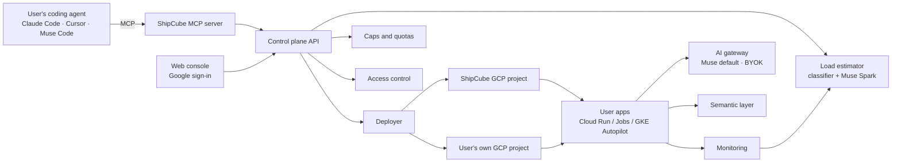

# ShipCube

**The infrastructure layer for apps you build with your coding agent.**

You build an internal app (a tracker, dashboard, report, API or scoring job) in Claude Code, Cursor, Muse Code or any other MCP-capable coding agent. Your agent connects to ShipCube's MCP server, and ShipCube handles the infrastructure:

- **Load estimation:** predicts how the app will behave (batch, bursty, steady, memory-heavy, I/O-bound) and sizes it.
- **Caps:** spend, rate and resource limits for each app, so nothing runs away.
- **Deployment on GCP:** Cloud Run services, Cloud Run jobs or GKE Autopilot, chosen from the load estimate. It runs on ShipCube's GCP project or on **your own GCP project and credits**, linked with Google sign-in.
- **Access control:** only the owner and the people they allow can open an app.
- **Data:** a minimal typed semantic layer, so apps run on any customer set without code changes.
- **AI for your apps:** apps that need a model get one through ShipCube's AI gateway. Muse is the default; you can also bring your own key.
- **Continuous monitoring:** health, data freshness, cost and drift, with suggestions to move an app when it outgrows its tier.

Built for the Meta Global AI Developer Hackathon (Indie track) on Meta's Muse models.

## Try it locally

Everything runs on one machine with Docker. You don't need a Google Cloud account, gcloud, a model API key or any private repository. The local stack runs the same code as production with local backends: fake GCS for uploads, a Secret Manager emulator, a local IAP, Docker for apps and the load profiler, and DuckDB for the demo warehouse.

**You need:** Docker (on macOS, Colima: `brew install colima docker docker-compose && colima start --cpu 4 --memory 6`, with the checkout under your home directory), `python3`, `uv` and `openssl`. You also need Node 22, but only for the console. The first `make up` takes about 10–15 minutes and several GB, because it builds the images and pulls the buildpacks builder. Later runs take about a minute.

```bash
git clone https://github.com/Kunal-Shahi/shipcube && cd shipcube
make up      # builds, migrates, seeds a demo user and workspace; starts the API + MCP server, worker, AI gateway, uploads and IAP
make smoke   # drives all 16 MCP tools end to end: estimate, deploy, open the app, inspect, data, delete and restore, plus the gateway
```

`make smoke` should end with 24 passed and 0 failed. CI runs the same `make up && make smoke` on every change (job `local-stack`).

**Connect your coding agent** (Claude Code shown here; any MCP client works):

```bash
claude mcp add --transport http shipcube-local http://localhost:18080/mcp --header "Authorization: Bearer $(grep ^SHIPCUBE_PAT= deploy/local/.state/seed.env | cut -d= -f2)"
```

Then ask it to estimate and deploy `examples/hello-ai`. Deployed apps open at `http://<service>.localhost:8088`. Sign in once at `http://localhost:8088/_iap/login`.

**Open the console** in mock sign-in mode against the local stack, at http://localhost:3100. The demo sign-in doesn't contact Google, and it acts as the seeded user:

```bash
cd apps/web && npm install
SHIPCUBE_DEV_MODE=1 AUTH_PROVIDER=mock \
SHIPCUBE_API_URL=http://localhost:18080 SHIPCUBE_MCP_URL=http://localhost:18080/mcp \
SHIPCUBE_DEV_API_SESSION=$(grep ^SHIPCUBE_DEV_CONSOLE_TOKEN= ../../deploy/local/.state/seed.env | cut -d= -f2) \
npm run dev -- --port 3100
```

**Without a model key:**

- The load estimator explains its choices with built-in rules (`explained_by=rules`).
- The AI gateway answers app calls with a built-in mock provider. Those calls are still authenticated, capped and metered, like real ones.

For real models, put `MUSE_API_KEY=...` in a repo-root `.env` (billed by Meta), or set `LOCAL_LLM=ollama` in `deploy/local/.env` for a small local model. Stop the stack with `make down`. For details, every component's switch and a runbook, see [docs/LOCAL.md](docs/LOCAL.md).

**The data layer on its own.** The semantic layer lives in [Kunal-Shahi/shipcube-data](https://github.com/Kunal-Shahi/shipcube-data). It's public and was created on 2026-10-27 for this hackathon. It uses DuckDB with the olist e-commerce demo data, and this repo pins it by commit. To run it by itself:

```bash
git clone https://github.com/Kunal-Shahi/shipcube-data && cd shipcube-data
uv sync --locked
.venv/bin/shipcube-data seed && .venv/bin/shipcube-data smoke
```

## How it works



Design: [docs/ARCHITECTURE.md](docs/ARCHITECTURE.md) · Who works on what: [docs/WORKSTREAMS.md](docs/WORKSTREAMS.md) · Build plan: [docs/PLAN.md](docs/PLAN.md)

## Repository layout

```
apps/web/                 Web console: sign-up, sign-in, MCP setup guide, apps, access, caps, monitoring
services/mcp/             MCP server that coding agents connect to
services/api/             Control-plane API
services/gateway/         Edge and access proxy for deployed apps; AI gateway
packages/semantic/        Minimal DSL, validator, IR, compiler, dialects
packages/profiler/        Sandboxed execution and resource capture
packages/placement/       Load estimation, tier mapping, resource sizing, cost estimate
packages/monitor/         Telemetry, checks, alerts, re-placement
packages/providers/       Model providers: Meta (default), BYOK OpenAI-compatible, OpenAI, Anthropic
infra/                    GCP infrastructure as code
ml/workload-classifier/   Trace ingestion, features, training, evaluation
evals/                    Compiler correctness, classifier benchmarks, end-to-end runs
docs/                     Architecture, research, plan
```

## Private dependencies

ShipCube runs standalone for evaluation, with no private credentials: `make up` uses only local backends (above). The private parts are the maintainer's own hosted deployment, which is used only on the hosted path and never for local evaluation:

- **Google Cloud:** Cloud Run, Cloud Build, Cloud SQL, GCS, Secret Manager and Identity Platform in our own GCP projects. They host the public service. `infra/`, `deploy/*.sh` and `deploy/services/` deploy to them.
- **Meta's Muse model API** (`META_API_KEY` or `MUSE_API_KEY`): real model calls. Without a key, the estimator uses rules and the gateway uses its mock provider.
- **Google OAuth** (`GOOGLE_OAUTH_CLIENT_ID` and `_SECRET`): console sign-in on the hosted path. Locally, the console uses a mock sign-in.

All of these are set through environment variables (see `.env.example`). The public repository runs end to end without any of them. The one other dependency, [shipcube-data](https://github.com/Kunal-Shahi/shipcube-data), is public; without it, `/v1/data/*` answers 501. No secrets are committed to this repository.

## Provenance

Everything in this repository and in shipcube-data was built during hackathon week, from 27 October to 1 November 2026. This repository was created on 2026-10-27.

- **The AI gateway** (`services/gateway`) was written for this hackathon, in this repository. It's Go, using the standard library only: there are no third-party dependencies and no `go.sum`. Its first code commit is b403257 (2026-10-27), and its last change is 5e53c1c (2026-10-31).
- **The data layer** ([shipcube-data](https://github.com/Kunal-Shahi/shipcube-data)) is a companion repository created on 2026-10-27.

The only pre-existing products used are Google Cloud and Meta's Muse models.

## License

Apache-2.0. See [LICENSE](LICENSE).
