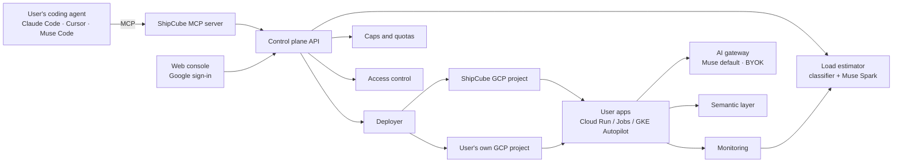

# ShipCube

**The infrastructure layer for apps you build with your coding agent.**

You build an internal app (a tracker, dashboard, report, API or scoring job) in Claude Code, Cursor, Muse Code or any other MCP-capable coding agent. Your agent connects to ShipCube's MCP server, and ShipCube handles the infrastructure:

- **Load estimation:** predicts how the app will behave (batch, bursty, steady, memory-heavy, I/O-bound) and sizes it.
- **Caps:** spend, rate and resource limits for each app, so nothing runs away.
- **Deployment on GCP:** Cloud Run services, Cloud Run jobs or GKE Autopilot, chosen from the load estimate. It runs on ShipCube's GCP project or on **your own GCP project and credits**, linked with Google sign-in.
- **Access control:** only the owner and the people they allow can open an app.
- **Data:** a minimal typed semantic layer, so apps run on any customer set without code changes.
- **AI for your apps:** apps that need a model get one through ShipCube's AI gateway. Muse is the default; you can also bring your own key.
- **Continuous monitoring:** health, data freshness, cost and drift, with suggestions to move an app when it outgrows its tier.

Built for the Meta Global AI Developer Hackathon (Indie track) on Meta's Muse models.

## How it works



Design: [docs/ARCHITECTURE.md](docs/ARCHITECTURE.md) · Who works on what: [docs/WORKSTREAMS.md](docs/WORKSTREAMS.md) · Build plan: [docs/PLAN.md](docs/PLAN.md)

## Repository layout

```
apps/web/                 Web console: sign-up, sign-in, MCP setup guide, apps, access, caps, monitoring
services/mcp/             MCP server that coding agents connect to
services/api/             Control-plane API
services/gateway/         Edge and access proxy for deployed apps; AI gateway
packages/semantic/        Minimal DSL, validator, IR, compiler, dialects
packages/profiler/        Sandboxed execution and resource capture
packages/placement/       Load estimation, tier mapping, resource sizing, cost estimate
packages/monitor/         Telemetry, checks, alerts, re-placement
packages/providers/       Model providers: Meta (default), BYOK OpenAI-compatible, OpenAI, Anthropic
infra/                    GCP infrastructure as code
ml/workload-classifier/   Trace ingestion, features, training, evaluation
evals/                    Compiler correctness, classifier benchmarks, end-to-end runs
docs/                     Architecture, research, plan
```

## License

Apache-2.0
