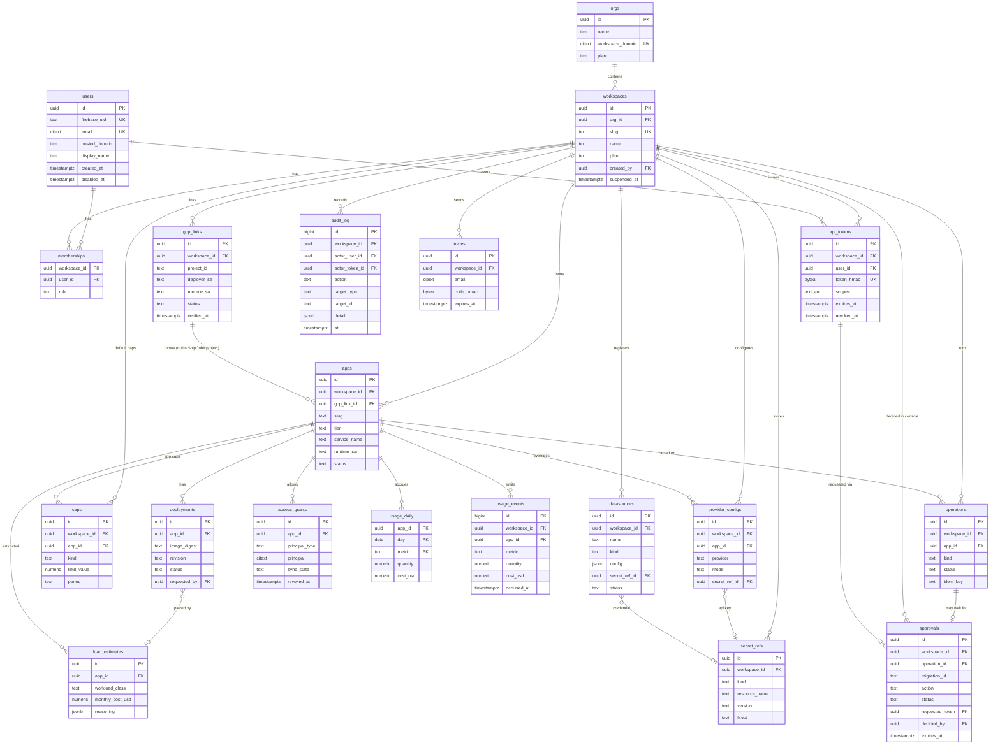

# Database design

Owner: infra and security workstream. Status: proposal (Oct 27). This schema follows from the decisions in [security-tenancy.md](security-tenancy.md): Identity Platform users, workspaces as the tenant boundary, IAP allow-lists mirrored in `access_grants`, per-workspace GCP links, Secret Manager references only, and hashed tokens.

## 1. Postgres or Firestore

| | Cloud SQL for PostgreSQL (Enterprise, `db-f1-micro`) | AlloyDB | Firestore (Native mode) |
|---|---|---|---|
| Monthly cost | About $8–12 for compute, plus about $0.17/GB for SSD storage; shared-core, so no SLA [D1][D2] | Smallest instances cost hundreds of dollars a month [D3] | Free tier: 1 GiB, 50k reads, 20k writes and 20k deletes per day per project [D4] |
| Over the 90-day trial | ~$30 of the $300 | Most of the $300 | ~$0 |
| Tenant isolation | **Row-level security** in the database | Same as Postgres | Security rules apply to client SDK access only; the server's Admin SDK bypasses them, so isolation is all application code |
| Data shape fit | Relational: grants, caps, deployments and usage roll-ups need joins, unique constraints and transactions (for example "at most 3 apps per free workspace") | Same | Document model; counters and uniqueness need transactions and extra index documents |
| Analytics (cost per app, per day) | SQL `GROUP BY`, partial indexes | Same | Needs BigQuery export or client-side aggregation |
| Local dev | `docker run postgres` | Same | Emulator |

**Recommendation: Cloud SQL for PostgreSQL 16, Enterprise edition, `db-f1-micro`, 10 GB SSD, in `shipcube-control`.** It costs about 3% of the credit pool for the trial, and in return we get row-level security as a second isolation layer, foreign keys and transactional cap checks. Connection is through the Cloud SQL connector from Cloud Run with IAM database authentication; no public authorized networks. Automated daily backups on, point-in-time recovery off (cost). AlloyDB is out on cost. Firestore would be free but pushes every isolation guarantee into application code.

If the budget gets tight, the schema has no Postgres-only features we can't drop, except RLS.

## 2. Entity-relationship diagram



## 3. Tables

DDL draft (Postgres 16). `citext` and `pgcrypto` extensions. All timestamps are `timestamptz`, all IDs are UUIDv7 generated by the application (time-ordered, good index locality) unless noted.

```sql
create extension if not exists citext;
create extension if not exists pgcrypto;

-- Identity -------------------------------------------------------------

create table users (
  id             uuid primary key,
  firebase_uid   text not null unique,            -- Identity Platform `sub`
  email          citext not null unique,
  email_verified boolean not null default false,
  hosted_domain  citext,                          -- Google `hd` claim; null for gmail.com
  display_name   text,
  avatar_url     text,
  created_at     timestamptz not null default now(),
  last_login_at  timestamptz,
  disabled_at    timestamptz
);

-- An org groups workspaces, usually one Google Workspace domain. Optional for personal users.
create table orgs (
  id               uuid primary key,
  name             text not null,
  workspace_domain citext unique,                -- lets "anyone @acme.com" join
  plan             text not null default 'free' check (plan in ('free','team','enterprise')),
  created_at       timestamptz not null default now()
);

-- The tenant boundary. Every tenant-owned row carries workspace_id.
create table workspaces (
  id           uuid primary key,
  org_id       uuid references orgs(id),
  slug         text not null unique check (slug ~ '^[a-z0-9-]{3,40}$'),
  name         text not null,
  plan         text not null default 'free' check (plan in ('free','team','enterprise')),
  created_by   uuid not null references users(id),
  created_at   timestamptz not null default now(),
  suspended_at timestamptz,
  suspended_reason text
);

create table memberships (
  workspace_id uuid not null references workspaces(id) on delete cascade,
  user_id      uuid not null references users(id) on delete cascade,
  role         text not null check (role in ('owner','admin','developer','viewer')),
  created_at   timestamptz not null default now(),
  primary key (workspace_id, user_id)
);

-- Signup gating and workspace invites (also used by the beforeCreate blocking function).
create table invites (
  id           uuid primary key,
  workspace_id uuid references workspaces(id) on delete cascade,  -- null = platform signup invite
  email        citext,                                            -- null = code-only invite
  code_hmac    bytea unique,
  role         text not null default 'developer',
  max_uses     int not null default 1,
  uses         int not null default 0,
  created_by   uuid references users(id),
  expires_at   timestamptz not null,
  created_at   timestamptz not null default now()
);

-- GCP projects -----------------------------------------------------------

create table gcp_links (
  id            uuid primary key,
  workspace_id  uuid not null references workspaces(id) on delete cascade,
  project_id    text not null,
  project_number text,
  deployer_sa   text not null,      -- ws-<id>-deployer@shipcube-control.iam.gserviceaccount.com
  runtime_sa    text not null,      -- shipcube-apps@<project>.iam.gserviceaccount.com
  region        text not null default 'asia-south1',
  iap_oauth_client_secret_ref uuid, -- FK added below; null = Google-managed client
  status        text not null check (status in ('pending','active','broken','revoked')),
  missing_permissions text[] not null default '{}',
  linked_by     uuid not null references users(id),
  verified_at   timestamptz,
  revoked_at    timestamptz,
  created_at    timestamptz not null default now()
);
-- A project can be actively linked to only one workspace at a time.
create unique index gcp_links_active_project on gcp_links (project_id) where status in ('pending','active','broken');

-- Apps and deployments ---------------------------------------------------

create table apps (
  id            uuid primary key,
  workspace_id  uuid not null references workspaces(id) on delete cascade,
  gcp_link_id   uuid references gcp_links(id),   -- null = hosted in shipcube-apps
  slug          text not null check (slug ~ '^[a-z0-9-]{3,40}$'),
  name          text not null,
  tier          text not null check (tier in ('T0','T1','T2','T3','T4')),
  kind          text not null check (kind in ('service','job','static')),
  service_name  text,                -- Cloud Run service or job name
  region        text not null,
  url           text,
  runtime_sa    text,                -- per-app service account
  status        text not null default 'draft'
                check (status in ('draft','deploying','running','paused','failed','deleted')),
  created_by    uuid not null references users(id),
  created_at    timestamptz not null default now(),
  -- Soft delete (delete_app, after approval): the service is scaled to zero and its IAP
  -- bindings removed, but the image, grants and secrets are kept until purge_after.
  status_before_delete text,
  deleted_at    timestamptz,
  deleted_by    uuid references users(id),
  purge_after   timestamptz,         -- deleted_at + 7 days; restore is allowed until then
  purged_at     timestamptz,
  check ((deleted_at is null) = (purge_after is null)),
  check (status <> 'deleted' or deleted_at is not null)
);
-- A slug is free again once its app is deleted. Restoring fails if a new app took the slug.
create unique index apps_slug_live on apps (workspace_id, slug) where deleted_at is null;

create table load_estimates (
  id                uuid primary key,
  workspace_id      uuid not null references workspaces(id) on delete cascade,
  app_id            uuid not null references apps(id) on delete cascade,
  workload_class    text not null,
  confidence        numeric(4,3),
  recommended_tier  text not null,
  cpu               numeric(5,2),
  memory_mib        int,
  monthly_cost_usd  numeric(10,2),
  profile           jsonb not null default '{}',   -- CPU, RSS, I/O, wall time samples summary
  reasoning         jsonb not null default '{}',   -- Muse Spark explanation
  created_at        timestamptz not null default now()
);

create table deployments (
  id               uuid primary key,
  workspace_id     uuid not null references workspaces(id) on delete cascade,
  app_id           uuid not null references apps(id) on delete cascade,
  load_estimate_id uuid references load_estimates(id),
  image_digest     text,             -- sha256:..., never a mutable tag
  revision         text,             -- Cloud Run revision name
  config           jsonb not null,   -- cpu, memory, max_instances, env var NAMES (never values)
  status           text not null check (status in ('queued','building','deploying','succeeded','failed','rolled_back')),
  error            text,
  requested_by     uuid references users(id),
  requested_via    text not null check (requested_via in ('console','mcp','system')),
  token_id         uuid,             -- api_tokens.id when via MCP
  created_at       timestamptz not null default now(),
  finished_at      timestamptz
);

-- Access (mirrors IAP bindings) -------------------------------------------

create table access_grants (
  id             uuid primary key,
  workspace_id   uuid not null references workspaces(id) on delete cascade,
  app_id         uuid not null references apps(id) on delete cascade,
  principal_type text not null check (principal_type in ('user','group','domain')),
  principal      citext not null,  -- email, group email, or domain
  granted_by     uuid not null references users(id),
  sync_state     text not null default 'pending' check (sync_state in ('pending','applied','failed','removing')),
  last_synced_at timestamptz,
  created_at     timestamptz not null default now(),
  revoked_at     timestamptz,
  revoked_by     uuid references users(id)
);
create unique index access_grants_live on access_grants (app_id, principal_type, principal) where revoked_at is null;

-- Caps (workspace defaults when app_id is null) ------------------------------

create table caps (
  id           uuid primary key,
  workspace_id uuid not null references workspaces(id) on delete cascade,
  app_id       uuid references apps(id) on delete cascade,
  kind         text not null check (kind in (
                 'max_instances','concurrency','cpu','memory_mib','request_timeout_s','job_timeout_s',
                 'requests_per_minute','ai_tokens_per_day','spend_usd_per_month','deploys_per_day','max_apps')),
  limit_value  numeric not null check (limit_value >= 0),
  period       text check (period in ('minute','day','month')),
  action       text not null default 'block' check (action in ('alert','throttle','block','pause')),
  set_by       uuid references users(id),
  updated_at   timestamptz not null default now()
);
create unique index caps_unique on caps (workspace_id, coalesce(app_id, '00000000-0000-0000-0000-000000000000'::uuid), kind);

-- Tokens ---------------------------------------------------------------

create table api_tokens (
  id           uuid primary key,
  workspace_id uuid not null references workspaces(id) on delete cascade,
  user_id      uuid not null references users(id) on delete cascade,
  kind         text not null check (kind in ('pat','oauth_refresh')),
  name         text not null,
  prefix       text not null,                -- first 8 chars, shown in UI
  token_hmac   bytea not null unique,        -- HMAC-SHA-256(pepper, secret)
  scopes       text[] not null check (scopes <@ array[
                 'apps:read','apps:deploy','access:write','caps:write','secrets:write',
                 'data:read','data:migrate','data:raw']),
  client_id    text,                         -- MCP OAuth client, if any
  expires_at   timestamptz not null,
  last_used_at timestamptz,
  last_used_ip inet,
  created_at   timestamptz not null default now(),
  revoked_at   timestamptz,
  check (expires_at <= created_at + interval '90 days')
);

-- Secrets: references only ----------------------------------------------

create table secret_refs (
  id            uuid primary key,
  workspace_id  uuid not null references workspaces(id) on delete cascade,
  app_id        uuid references apps(id) on delete cascade,
  kind          text not null check (kind in ('ai_key','db_credential','warehouse_credential','iap_oauth_client','other')),
  label         text not null,
  resource_name text not null unique,   -- projects/P/secrets/ws-<id>-ai_key-<uuid>
  version       text not null,          -- pinned version number, never 'latest'
  last4         text,
  fingerprint   bytea,                  -- SHA-256 of the value, to detect re-uploads
  rotated_at    timestamptz,
  created_by    uuid references users(id),
  created_at    timestamptz not null default now(),
  destroyed_at  timestamptz
);
alter table gcp_links add foreign key (iap_oauth_client_secret_ref) references secret_refs(id);

create table provider_configs (
  id            uuid primary key,
  workspace_id  uuid not null references workspaces(id) on delete cascade,
  app_id        uuid references apps(id) on delete cascade,  -- null = workspace default
  provider      text not null check (provider in ('meta','openai_compatible','openai','anthropic')),
  model         text not null,
  base_url      text,                    -- validated: https only, no private IPs
  secret_ref_id uuid references secret_refs(id),
  updated_by    uuid references users(id),
  updated_at    timestamptz not null default now(),
  check (provider = 'meta' or secret_ref_id is not null)
);
create unique index provider_configs_scope on provider_configs (workspace_id, coalesce(app_id, '00000000-0000-0000-0000-000000000000'::uuid));

-- Usage and cost ----------------------------------------------------------

create table usage_events (
  id           bigint generated always as identity,
  workspace_id uuid not null,
  app_id       uuid,
  metric       text not null check (metric in ('requests','vcpu_seconds','gib_seconds','build_minutes','ai_input_tokens','ai_output_tokens','egress_bytes')),
  quantity     numeric not null,
  cost_usd     numeric(12,6) not null default 0,
  source       text not null check (source in ('gateway','cloud_monitoring','billing_export','estimate')),
  occurred_at  timestamptz not null,
  primary key (occurred_at, id)
) partition by range (occurred_at);   -- monthly partitions; drop after 90 days

create table usage_daily (
  workspace_id uuid not null,
  app_id       uuid not null,
  day          date not null,
  metric       text not null,
  quantity     numeric not null,
  cost_usd     numeric(12,4) not null,
  primary key (app_id, day, metric)
);

-- Long-running operations (networking's step machine, driven by Cloud Tasks) ----

create table operations (
  id             uuid primary key,
  workspace_id   uuid not null references workspaces(id) on delete cascade,
  app_id         uuid references apps(id) on delete set null,
  kind           text not null check (kind in ('estimate','deploy','delete','restore','purge','set_caps','set_access',
                                               'profile','link_verify','grant_sync')),
  target_project text not null,          -- shipcube-apps or the linked project
  -- Same values as networking's OpStatus, plus awaiting_approval. A rejected or expired
  -- approval moves the operation to cancelled.
  status         text not null check (status in ('awaiting_approval','queued','running','succeeded','failed','cancelled')),
  step           text,
  step_state     jsonb not null default '{}',  -- no secret values
  attempts       int not null default 0,
  idem_key       text not null,
  request_hash   bytea not null,
  requested_by   uuid references users(id),
  token_id       uuid,
  error          text,
  created_at     timestamptz not null default now(),
  updated_at     timestamptz not null default now(),
  unique (workspace_id, idem_key)
);
alter table deployments add column operation_id uuid references operations(id);

-- Approvals (decided Oct 28). Agents act directly within defaults; these actions wait for a
-- human in the console:
--   first_linked_deploy  first deploy_app to a linked GCP project
--   cap_raise            set_caps above the workspace default
--   domain_grant         set_access add with a domain: principal
--   delete_app           delete_app (soft delete)
--   apply_migration      a data-layer migration (agents can only propose)
create table approvals (
  id               uuid primary key,
  workspace_id     uuid not null references workspaces(id) on delete cascade,
  action           text not null check (action in
                     ('first_linked_deploy','cap_raise','domain_grant','delete_app','apply_migration')),
  operation_id     uuid unique references operations(id) on delete cascade,
  migration_id     text,              -- data-layer migrations.id, e.g. '0006_net_revenue'
  app_id           uuid references apps(id),
  summary          text not null,     -- one line for the console, e.g. 'Grant domain:acme.com on tracker'
  request          jsonb not null,    -- the exact normalized arguments the approver sees
  request_hash     bytea not null,    -- SHA-256 of request; checked again before executing
  requested_by     uuid references users(id),
  requested_via    text not null check (requested_via in ('mcp','console')),
  requested_token  uuid references api_tokens(id),
  status           text not null default 'pending'
                   check (status in ('pending','approved','rejected','expired','cancelled')),
  decided_by       uuid references users(id),
  decided_via      text check (decided_via = 'console'),   -- never a token
  decided_at       timestamptz,
  decision_note    text,
  expires_at       timestamptz not null,                   -- created_at + 72 hours
  created_at       timestamptz not null default now(),
  check ((action = 'apply_migration') = (migration_id is not null)),
  check ((action = 'apply_migration') or operation_id is not null),
  check ((status = 'pending') = (decided_at is null)),  -- the system sets decided_at on expiry and cancel too
  check (status not in ('approved','rejected') or decided_by is not null)
);
-- One open approval per migration.
create unique index approvals_migration_open on approvals (workspace_id, migration_id)
  where migration_id is not null and status = 'pending';

-- Warehouse datasources, registered in the console only (credentials never pass through an agent).
create table datasources (
  id             uuid primary key,
  workspace_id   uuid not null references workspaces(id) on delete cascade,
  name           text not null check (name ~ '^[a-z0-9_-]{2,40}$'),
  kind           text not null check (kind in ('bigquery','postgres','cloudsql_postgres','snowflake','duckdb_gcs')),
  config         jsonb not null,     -- non-secret: project/dataset, host/port/database, schemas, region
  secret_ref_id  uuid references secret_refs(id),   -- password, key file or connection string; null for BigQuery via IAM
  auth_mode      text not null check (auth_mode in ('secret','service_account')),
  egress         text not null default 'default' check (egress in ('default','static')),
  status         text not null default 'pending' check (status in ('pending','connected','error','disabled')),
  last_checked_at timestamptz,
  last_error     text,
  created_by     uuid not null references users(id),
  created_via    text not null default 'console' check (created_via = 'console'),
  created_at     timestamptz not null default now(),
  deleted_at     timestamptz,
  check ((auth_mode = 'secret') = (secret_ref_id is not null))
);
create unique index datasources_name_live on datasources (workspace_id, name) where deleted_at is null;

-- Gateway rate counters, shared by all gateway instances. Unlogged: faster writes, and
-- losing them in a crash only resets the current window.
create unlogged table rate_counters (
  app_id       uuid not null,
  kind         text not null check (kind in ('requests_per_minute','ai_tokens_per_day')),
  window_start timestamptz not null,
  count        bigint not null default 0,
  primary key (app_id, kind, window_start)
);

-- Audit -----------------------------------------------------------------

create table audit_log (
  id             bigint generated always as identity primary key,
  workspace_id   uuid,                 -- null for platform-level events
  actor_user_id  uuid,
  actor_token_id uuid,
  actor_type     text not null check (actor_type in ('user','token','system')),
  action         text not null,        -- e.g. app.deploy, access.grant, gcp_link.revoke
  target_type    text not null,
  target_id      text not null,
  detail         jsonb not null default '{}',  -- before/after without secret values
  ip             inet,
  user_agent     text,
  at             timestamptz not null default now()
);
```

Notes:

- **No secret values anywhere.** `secret_refs` holds the Secret Manager resource name, version, `last4` and a fingerprint. `deployments.config` stores env var *names*. Tokens are stored only as HMACs.
- `usage_events` and `audit_log` have no foreign keys on purpose: they must survive deletes, and the write path should be cheap.
- Soft deletes (`deleted_at`, `revoked_at`) keep history for the audit trail; a nightly job hard-deletes rows older than the retention period (90 days for usage events; audit log kept for a year).

## 4. Indexes

Beyond primary keys and the unique indexes above:

```sql
create index memberships_user          on memberships (user_id);
create index gcp_links_workspace       on gcp_links (workspace_id);
create index apps_workspace_status     on apps (workspace_id, status) where deleted_at is null;
create index apps_gcp_link             on apps (gcp_link_id) where gcp_link_id is not null;
create index deployments_app_created   on deployments (app_id, created_at desc);
create index deployments_inflight      on deployments (status) where status in ('queued','building','deploying');
create index access_grants_app         on access_grants (app_id) where revoked_at is null;
create index access_grants_unsynced    on access_grants (sync_state) where sync_state <> 'applied';
create index access_grants_principal   on access_grants (principal) where revoked_at is null;  -- "what can bob@x see?"
create index caps_app                  on caps (app_id);
create index operations_active         on operations (status, updated_at) where status in ('queued','running');
create index approvals_pending         on approvals (workspace_id, created_at desc) where status = 'pending';
create index apps_purge_due            on apps (purge_after) where deleted_at is not null and purged_at is null;
create index datasources_workspace     on datasources (workspace_id) where deleted_at is null;
create index operations_ws_created     on operations (workspace_id, created_at desc);
create index api_tokens_user           on api_tokens (user_id) where revoked_at is null;
create index secret_refs_workspace     on secret_refs (workspace_id) where destroyed_at is null;
create index load_estimates_app        on load_estimates (app_id, created_at desc);
create index usage_events_app_time     on usage_events (app_id, occurred_at);
create index usage_daily_ws_day        on usage_daily (workspace_id, day);
create index audit_ws_time             on audit_log (workspace_id, at desc);
create index audit_target              on audit_log (target_type, target_id);
```

Token lookup is by the unique `token_hmac` index: the API computes the HMAC of the presented secret and does one equality lookup, so there's no timing side channel from string comparison.

## 5. Row-level security

The application connects as `shipcube_app`, which **does not own the tables** and does not have `BYPASSRLS`. For each request, inside a transaction, the API sets the caller:

```sql
begin;
select set_config('app.user_id', $1, true);       -- true = local to this transaction
select set_config('app.workspace_id', $2, true);  -- the workspace in the URL or token
select set_config('app.via', $3, true);           -- 'console', 'mcp' or 'app'
-- ... queries ...
commit;
```

Policies (same pattern on every tenant table):

```sql
create function app_user() returns uuid language sql stable as
  $$ select nullif(current_setting('app.user_id', true), '')::uuid $$;
create function app_workspace() returns uuid language sql stable as
  $$ select nullif(current_setting('app.workspace_id', true), '')::uuid $$;
-- 'console' (Identity Platform session), 'mcp' (PAT or OAuth token) or 'app' (deployed app).
create function app_via() returns text language sql stable as
  $$ select current_setting('app.via', true) $$;

-- True if the current user is a member of the workspace in context with at least min_role.
create function app_has_role(min_role text) returns boolean language sql stable security definer
set search_path = public as $$
  select exists (
    select 1 from memberships m
    where m.workspace_id = app_workspace() and m.user_id = app_user()
      and array_position(array['viewer','developer','admin','owner'], m.role)
          >= array_position(array['viewer','developer','admin','owner'], min_role))
$$;

alter table apps enable row level security;
alter table apps force row level security;

create policy apps_read  on apps for select using (workspace_id = app_workspace() and app_has_role('viewer'));
create policy apps_write on apps for insert with check (workspace_id = app_workspace() and app_has_role('developer'));
create policy apps_update on apps for update using (workspace_id = app_workspace() and app_has_role('developer'))
                                          with check (workspace_id = app_workspace());

-- Sharing and secrets need admin.
alter table access_grants enable row level security;
alter table access_grants force row level security;
create policy grants_read  on access_grants for select using (workspace_id = app_workspace() and app_has_role('viewer'));
create policy grants_write on access_grants for all using (workspace_id = app_workspace() and app_has_role('admin'))
                                             with check (workspace_id = app_workspace());

-- Apply the same to: gcp_links, deployments, load_estimates, caps, secret_refs, provider_configs,
-- api_tokens (plus user_id = app_user() for non-admins), usage_daily, invites.

-- Approvals: anyone in the workspace can see them and agents can create them, but only a
-- human in the console with admin can decide. The API also checks this; RLS is the backstop.
alter table approvals enable row level security;
alter table approvals force row level security;
create policy approvals_read   on approvals for select using (workspace_id = app_workspace() and app_has_role('viewer'));
create policy approvals_create on approvals for insert with check (
  workspace_id = app_workspace() and app_has_role('developer') and status = 'pending');
create policy approvals_decide on approvals for update
  using (workspace_id = app_workspace() and status = 'pending' and app_via() = 'console'
         and app_has_role(case when action = 'apply_migration' then 'developer' else 'admin' end))
  with check (workspace_id = app_workspace() and decided_by = app_user() and decided_via = 'console');

-- Datasources: console only, admin to write.
alter table datasources enable row level security;
alter table datasources force row level security;
create policy datasources_read  on datasources for select using (workspace_id = app_workspace() and app_has_role('viewer'));
create policy datasources_write on datasources for all
  using (workspace_id = app_workspace() and app_has_role('admin') and app_via() = 'console')
  with check (workspace_id = app_workspace() and app_via() = 'console');

-- Audit log: append-only.
alter table audit_log enable row level security;
alter table audit_log force row level security;
create policy audit_insert on audit_log for insert with check (true);
create policy audit_read   on audit_log for select using (workspace_id = app_workspace() and app_has_role('admin'));
revoke update, delete, truncate on audit_log from shipcube_app;
```

Database roles:

| Role | Used by | Rights |
|---|---|---|
| `shipcube_owner` | migrations only (CI) | owns tables |
| `shipcube_app` | API, MCP server | DML subject to RLS; no `UPDATE`/`DELETE` on `audit_log` |
| `shipcube_worker` | reconciler, usage roll-up, budget kill switch | `BYPASSRLS`, but only `SELECT` on most tables and `UPDATE` on status/sync columns; runs no user-supplied queries |
| `shipcube_readonly` | debugging | `SELECT` with RLS |

Each maps to a Cloud SQL IAM database user tied to that service's service account, so there are no database passwords.

**Testing RLS:** a test fixture creates workspaces A and B and asserts that every API list and get endpoint, called as a user of A, returns nothing from B, and that writes into B fail.

## 6. Tokens and scopes (matches networking, PR #1)

- **Format:** `sc_pat_<id>_<secret>`; the 32-byte secret is shown once. `prefix` stores `sc_pat_<id>` for display.
- **Lookup:** `token_hmac = HMAC-SHA-256(pepper, full token)`, with the pepper in Secret Manager (`token-hmac-pepper`). A plain `sha256` would let anyone holding a database dump test guessed tokens offline; the pepper stops that. The API does one equality lookup on the unique index.
- **Scopes** (enforced by the check constraint, so a typo can't mint a token nobody can use):

| Scope | Allows | Used by |
|---|---|---|
| `apps:read` | `whoami`, `list_apps`, `inspect_app`, `operation` (get) | MCP, console |
| `apps:deploy` | `create_upload`, `estimate_load`, `deploy_app`, `delete_app`, `operation` (cancel) | MCP |
| `access:write` | `set_access` (`domain:` grants wait for approval) | MCP, console |
| `caps:write` | `set_caps` (raises above the workspace default wait for approval) | MCP, console |
| `secrets:write` | `ai_config` with a BYOK key | MCP, console |
| `data:read` | `data_list_cubes`, `data_describe_cube`, `data_query`, `data_search_values` | data layer |
| `data:migrate` | `data_propose_migration` only; applying happens in the console (section 8) | data layer |
| `data:raw` | L3 `raw_sql`, only if the workspace setting allows it | data layer |

- **Lifetime:** 30 days by default, 90 at most (check constraint). `last_used_at` and `last_used_ip` are updated at most once a minute per token, to avoid a write on every call.
- **Console:** the console doesn't use PATs. It sends the Identity Platform ID token as a bearer token (or a Firebase session cookie, which the Admin SDK can mint for up to 14 days). The API treats a console caller as having every scope its membership role allows.
- **Phase 2 OAuth 2.1:** refresh tokens go in `api_tokens` with `kind = 'oauth_refresh'` and `client_id` set. Access tokens are short-lived JWTs and aren't stored.

## 7. What the data layer reads (shipcube-data)

The data layer never parses tokens. For every request, the API (or the MCP server, in-process) builds the data layer's `Caller` from these tables and hands it over. This is the contract:

| `Caller` field | Source | Notes |
|---|---|---|
| `workspace_id`, `workspace_slug` | `workspaces.id`, `workspaces.slug` | Resolved from the token (`api_tokens.workspace_id`) or the console URL. Never from tool arguments |
| `user_id`, `email`, `hosted_domain` | `users.id`, `users.email`, `users.hosted_domain` | `hosted_domain` is the Google `hd` claim; null for gmail.com |
| `membership_role` | `memberships.role` | `owner > admin > developer > viewer`; null for someone who only reaches data through an app |
| `scopes` | `api_tokens.scopes` | Console callers get the scopes their role allows |
| `app_id` | `apps.id` | Set for traffic from a deployed app (below) |
| `groups` | empty unless the workspace connects Cloud Identity | Neither IAP nor the Google ID token tells us a user's groups. **Limit:** group principals in `data_role_assignments` match nothing until a workspace admin connects the Cloud Identity Groups API (security-tenancy, Known limits). The console warns when a data role is assigned to a group in a workspace without that connection |
| `via` | `console`, `mcp` or `app` | |

**Tenant id for schema routing:** `ws_` followed by the workspace UUID as 32 hex characters (e.g. `ws_0192f0c4…`). It is derived, not stored, so it can't drift, and it is always a valid SQL identifier. A sub-tenant inside a workspace comes from the data layer's own `data_attributes` (key `tenant`), never from the request.

**Principal types line up:** `access_grants.principal_type` (`user`, `group`, `domain`) plus `workspace_role` are exactly the principal types in the data layer's `data_role_assignments` and `data_attributes`. Emails and domains are compared case-insensitively (`citext` here; the data layer lower-cases).

**Requests from deployed apps.** When a viewer opens an app, IAP signs a JWT (`x-goog-iap-jwt-assertion`) naming the viewer's email. If the app calls the data layer for that viewer:

1. The app calls the API with an ID token for its own service account (`apps.runtime_sa` → `app_id`, `workspace_id`) and forwards the IAP assertion header.
2. The API verifies the IAP JWT (signature from Google's IAP keys, audience = that app's backend) and takes the viewer's email from it. It never trusts a plain email header.
3. `Caller` = the app's workspace, `app_id`, the viewer's email and domain, and the viewer's `membership_role` if they're also a workspace member (otherwise null). Row policies then filter on the *viewer*, not the app.

Without a valid IAP assertion (for example, a scheduled job), the caller is the app itself: `app_id` set, no email, and only row policies that allow it apply. The data layer fails closed when a `$ctx` value is missing.

**Catalog tables in Postgres:** the data layer's catalog lives in this same Cloud SQL database. Every catalog table gets `workspace_id uuid not null references workspaces(id)` and the same RLS policies built on `app_workspace()` and `app_has_role()` (section 5). Reading the catalog needs `viewer`; migrations need `developer` (and approval through the console); data roles and attributes need `admin`. Catalog changes write to the shared `audit_log` with `action` values prefixed `data.`.

## 8. Approvals, soft delete, migrations and datasources (decided Oct 28)

**Approval flow.** Networking's API owns the endpoints; these tables back them.

1. An agent calls a gated tool, for example `set_access` with `add: ["domain:acme.com"]`. The API creates an `operations` row with `status = 'awaiting_approval'` and an `approvals` row holding the normalized request, its hash, and the token that asked. The tool returns `status: awaiting_approval` and `approval_url` (`/w/<slug>/approvals/<id>` in the console).
2. In the console, an admin sees the summary and the exact arguments, and approves or rejects. The API only accepts a decision from a console session (`app.via = 'console'`); RLS enforces the same thing.
3. On approval the operation moves to `queued` and runs. Before running, the worker recomputes the hash of the operation's arguments and refuses if it differs from the approved one.
4. Rejected or expired after 72 hours: the approval becomes `rejected`/`expired` and the operation `cancelled`. `operation(action: get)` reports why.

When an action needs approval:

| Action | Needs approval when | Approver |
|---|---|---|
| `first_linked_deploy` | `deploy_app` to a `gcp_links` row with no succeeded deployment yet | admin |
| `cap_raise` | `set_caps` raises any cap above the workspace default (`caps` row with `app_id is null`, else the plan default) | admin |
| `domain_grant` | `set_access` adds a `domain:` principal. `user:` and `group:` grants and all removals go through directly | admin |
| `delete_app` | always | admin |
| `apply_migration` | always; agents can only propose | developer for additive migrations; the data layer may require admin for breaking ones |

A solo owner approves their own agent's requests. The protection is that the agent's token can't approve, not that a second person must.

**Soft delete.** An approved `delete_app` sets `status = 'deleted'`, `status_before_delete`, `deleted_at`, `deleted_by` and `purge_after = deleted_at + 7 days`. The deployer sets max instances to 0 and removes the IAP bindings, which stops cost and access, but keeps the Cloud Run service, image, `access_grants` rows and secrets. `restore` (console, or an operation of kind `restore`) clears the deletion fields, restores the old status and re-applies the grants; it fails if a live app has taken the slug. A daily `purge` operation deletes the Cloud Run service, images, per-app service account and secret versions for apps past `purge_after`, then sets `purged_at`. The row stays for the audit trail.

**Data-layer migrations.** The data layer's catalog `migrations` table (shipcube-data `catalog.py`) moves into this Postgres database with `workspace_id` and these extra columns:

```sql
-- Columns added to the data layer's migrations table in Postgres (it owns the rest).
alter table migrations
  add column workspace_id       uuid not null references workspaces(id),
  add column proposed_by_user   uuid references users(id),
  add column proposed_by_token  uuid references api_tokens(id),
  add column approval_id        uuid references approvals(id),
  add column applied_by_user    uuid references users(id),
  add column applied_via        text check (applied_via = 'console'),
  add constraint migrations_applied_needs_approval
    check (status not in ('approved','applied') or approval_id is not null),
  add constraint migrations_applied_by_human
    check (status <> 'applied' or (applied_by_user is not null and applied_via = 'console'));
```

`data_propose_migration` inserts `status = 'proposed'` and opens an `apply_migration` approval. Approving it in the console applies the migration in the same request, as that human. There is no MCP tool that applies.

**Datasources.** Warehouses are registered only in the console (`created_via = 'console'`, enforced by a check and by RLS). Non-secret settings go in `config`; the credential goes to Secret Manager and only its `secret_refs` id is stored. BigQuery can use `auth_mode = 'service_account'` (grant the workspace's data service account `bigquery.dataViewer` on the dataset), so no secret is stored at all. The data layer reads a datasource by id; agents see its name and kind through `data_list_cubes`, never its config or credential.

## 9. How decisions map to the schema

| Decision (security-tenancy.md) | Where it lives |
|---|---|
| Identity Platform sign-in | `users.firebase_uid`, `users.hosted_domain` |
| Invite-gated signup | `invites` (checked by the `beforeCreate` blocking function) |
| IAP allow-list | `access_grants` (source of truth) + reconciler syncing IAM bindings |
| Per-workspace deployer SA | `gcp_links.deployer_sa`; partial unique index stops two workspaces linking the same project |
| Per-app service accounts | `apps.runtime_sa` |
| Secret Manager only | `secret_refs`, `provider_configs.secret_ref_id`, `gcp_links.iap_oauth_client_secret_ref` |
| Hashed, scoped, expiring tokens | `api_tokens` (section 6) |
| Idempotent long-running work | `operations` (`unique (workspace_id, idem_key)`) |
| Data-layer identity | section 7 |
| Approvals for risky agent actions | `approvals`, `operations.status = 'awaiting_approval'`, RLS on `app_via()` (section 8) |
| Soft delete, 7-day restore | `apps.deleted_at`, `purge_after` |
| Console-only warehouses | `datasources` |
| Caps | `caps` (workspace defaults and per-app overrides), `usage_daily` to enforce spend and token caps |
| Audit | `audit_log` plus Cloud Audit Logs |

## Sources

- [D1] Cloud SQL pricing: https://cloud.google.com/sql/pricing
- [D2] Third-party summary of `db-f1-micro` pricing (July 2026): https://www.bytebase.com/dbcost/cloudsql/instance/db-f1-micro/
- [D3] AlloyDB pricing: https://cloud.google.com/alloydb/pricing
- [D4] Free Google Cloud features (Firestore free tier): https://docs.cloud.google.com/free/docs/free-cloud-features
- [D5] Cloud SQL IAM database authentication: https://docs.cloud.google.com/sql/docs/postgres/iam-authentication
- [D6] PostgreSQL row security policies: https://www.postgresql.org/docs/16/ddl-rowsecurity.html
