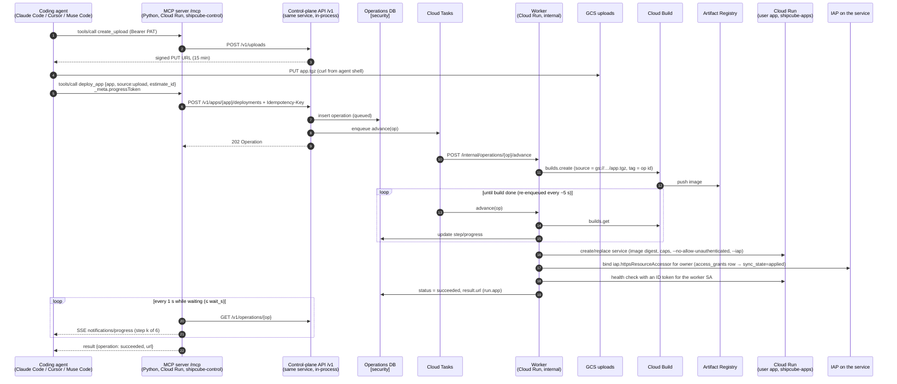
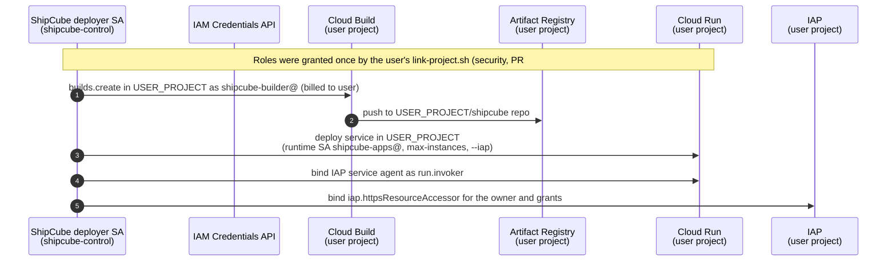

# Backend networking

**Workstream:** backend networking · **Owns:** this doc, `services/mcp/**`, `services/api/**` · **Status:** research done, stub servers running · **Researched:** Oct 27, 2026

This doc covers how a coding agent reaches ShipCube, how ShipCube reaches GCP, and how people reach the apps ShipCube deploys. Each section ends with a decision. Choices that depend on another workstream are marked **[security]** (Infra and security: identity, `services/gateway`, the database) or **[language]** (Go vs Python).

## TL;DR: decisions

| # | Topic | Decision for the 10-day build | Later |
|---|---|---|---|
| 1 | MCP transport | One remote **Streamable HTTP** endpoint, `https://mcp.shipcube.dev/mcp`, built on the stateless **2026-07-28** spec. No stdio package. | A stdio shim only if a client can't do remote HTTP |
| 1 | MCP auth | **Personal access token** (`sc_pat_<id>_<secret>`, stored as an HMAC per security's `api_tokens` table) from the web console, sent as `Authorization: Bearer`. | **OAuth 2.1** per the MCP authorization spec: ShipCube as the authorization server in front of Google sign-in, Client ID Metadata Documents first, DCR as fallback |
| 1 | Language | **Python 3.12**: the official `mcp` 2.3.0 SDK (`MCPServer`) plus FastAPI, run as **one service** (`/mcp` and `/v1/*`). Tools call the API in-process. Kunal's decision on PR #4. | Split MCP and API with `SHIPCUBE_API_URL` |
| 2 | Tools | **16 tools** (Kunal, Oct 28): 11 app tools plus 5 `data_*` tools mounted from shipcube-data (§2). Long-running tools return an **Operation**, wait up to `wait_s` (≤55 s) while streaming `notifications/progress`, then hand back the id for `operation`. **Idempotency keys** on every mutating call. Four kinds of action wait for a human: `awaiting_approval` + `approval_url` (§2.5). | The MCP `tasks` extension, once Claude Code and Cursor support it |
| 3 | Control plane | **REST + JSON**, OpenAPI 3.1, `/v1` in the path, AIP-151-style operations. No gRPC. Deploys and profiling run as a **step machine driven by Cloud Tasks**. | Workflows if the step graph grows |
| 4 | Flow | MCP → API → Cloud Tasks → worker → Cloud Build → Artifact Registry → Cloud Run. In a linked project the worker impersonates a deployer service account there. | |
| 5 | Reaching apps | **IAP directly on each Cloud Run service** (security's decision, PR #2): the app's `run.app` URL, Google sign-in, and `set_access` writes `access_grants` plus an IAM binding. No load balancer. **[security]** | `<app>.apps.shipcube.dev` through an ALB and the Go access proxy (`services/gateway`), if custom domains or per-request caps are needed |
| 5 | Egress | Default: none. Apps that need a static IP for a customer database use Direct VPC egress + Cloud NAT with a reserved IP, one per GCP project. | |
| 6 | Caps | Cloud Run handles instances, concurrency, CPU/memory and timeout. Requests per minute applies to AI-gateway calls only while apps sit behind IAP. Spend uses ShipCube's own cost meter plus a billing budget, and the kill switch is `max-instances=0`. | Per-request app caps through the access proxy or Cloud Armor |
| 6 | Budget | About **$5–20/month** fixed (Cloud SQL, plus NAT once a demo app needs a static IP). The access-proxy option adds ~$18 for the ALB. GKE Autopilot is placement-only. | |

---

## 1. MCP transport and auth

### 1.1 The spec moved: 2026-07-28 is stateless

The current MCP revision ([2026-07-28 changelog](https://modelcontextprotocol.io/specification/2026-07-28/changelog)) changes how a remote server is built:

- **No sessions, no `initialize` handshake.** `Mcp-Session-Id` is gone. Every request carries its protocol version, client info and capabilities in `_meta`, and servers implement `server/discover`. Any instance can answer any request, so a plain Cloud Run service with no session affinity works.
- **No standalone GET stream and no SSE resumability.** A request gets either a JSON reply or an SSE stream scoped to that request. If the stream breaks, the request is lost and the client re-issues it with a new id ([Streamable HTTP](https://modelcontextprotocol.io/specification/2026-07-28/basic/transports/streamable-http)). **Consequence for us:** any tool that starts work must be idempotent, because a retry is indistinguishable from a new call (§2.3).
- **Server→client requests (elicitation, sampling) became Multi Round-Trip Requests.** The server returns `resultType: "input_required"` and the client retries with `inputResponses`. We don't need this for v1, but `delete_app` could use it for confirmation later.
- **Tasks moved to an extension** (`io.modelcontextprotocol/tasks`), with polling via `tasks/get`.
- **Required request headers** `MCP-Protocol-Version`, `Mcp-Method` and `Mcp-Name` mirror the body, so a gateway or load balancer can route or rate-limit by tool name without parsing JSON.
- The old HTTP+SSE transport and the Roots, Sampling and Logging features are **deprecated**.

Clients on 2025-era versions still work: the official v2 SDKs answer the legacy `initialize` handshake alongside `server/discover` from the same endpoint ([SDK beta announcement](https://blog.modelcontextprotocol.io/posts/sdk-betas-2026-07-28/)). Our Python stub (`mcp` 2.3.0, `stateless_http=True`) was verified both ways: `claude mcp list` (Claude Code 2.1.308) connects to it, and the SDK's own client in `scripts/smoke.py` lists and calls all the tools.

### 1.2 Streamable HTTP vs stdio

| | Streamable HTTP (remote) | stdio (local subprocess) |
|---|---|---|
| Install | One URL: `claude mcp add --transport http …` | Users need Node, Python or a binary, plus updates |
| Credentials | Bearer token or OAuth per request | Env vars on the user's machine. The spec says stdio servers **SHOULD NOT** use the OAuth flow and should read credentials from the environment ([Authorization](https://modelcontextprotocol.io/specification/latest/basic/authorization)). |
| Where work runs | Our Cloud Run, next to the API | The user's laptop, which would still call our API over HTTPS |
| Uploading local code | Needs a signed-URL upload (§2.2) | Could read files directly |
| Updates | Deploy once | Every user upgrades |
| Clients | Claude Code ([docs](https://code.claude.com/docs/en/mcp)) and Cursor ([docs](https://cursor.com/docs/context/mcp)) both support remote HTTP, headers and OAuth | Universal |

stdio's only real advantage is reading local files, and the `create_upload` + `curl` pattern in §2.2 covers that, since every coding agent has a shell. **Decision: remote Streamable HTTP only.** If a client (possibly Muse Code; see below) only speaks stdio, ship a ~30-line stdio→HTTP bridge, or point users at the community `mcp-remote` bridge. Don't build a second server.

**How clients connect:**

```bash
# Claude Code (scopes: local [default], project → .mcp.json, user)
claude mcp add --transport http shipcube https://mcp.shipcube.dev/mcp \
  --header "Authorization: Bearer $SHIPCUBE_TOKEN"
```

```jsonc
// .mcp.json (Claude Code, committed to the repo). ${VAR} expands at load time.
{ "mcpServers": { "shipcube": { "type": "http", "url": "https://mcp.shipcube.dev/mcp",
    "headers": { "Authorization": "Bearer ${SHIPCUBE_TOKEN}" } } } }

// .cursor/mcp.json (Cursor). Note the ${env:NAME} syntax.
{ "mcpServers": { "shipcube": { "url": "https://mcp.shipcube.dev/mcp",
    "headers": { "Authorization": "Bearer ${env:SHIPCUBE_TOKEN}" } } } }
```

Gotchas from the Claude Code docs:
- A `url` without `"type": "http"` is read as stdio and skipped.
- Claude Code expands its own credential variables (`ANTHROPIC_API_KEY`, cloud-provider tokens, `NPM_TOKEN`, …) to an empty string in remote headers. Use our own name, `SHIPCUBE_TOKEN`.
- If a static `Authorization` header is rejected, Claude Code **does not fall back to OAuth**. This matters for the migration in §1.4.

**Muse Code:** I found no public documentation of its MCP client. **Action:** test it against the stub on day 2. If it only does stdio, use the bridge. The web console's MCP setup guide (frontend) should show all three snippets.

### 1.3 Auth options

**A. MCP authorization spec (OAuth 2.1).** In the [current spec](https://modelcontextprotocol.io/specification/latest/basic/authorization):
- The MCP server is an OAuth **resource server**. It **must** publish Protected Resource Metadata ([RFC 9728](https://datatracker.ietf.org/doc/html/rfc9728)) and return `401` with `WWW-Authenticate: Bearer resource_metadata="…"`.
- The client discovers the authorization server (RFC 8414 or OIDC discovery), runs auth code + **PKCE**, sends `resource=` ([RFC 8707](https://www.rfc-editor.org/rfc/rfc8707.html)), and validates `iss` (RFC 9207).
- The server **must** check that the token's audience is itself, and must not pass tokens through.
- Client registration priority: **Client ID Metadata Documents** (the client's `client_id` is an HTTPS URL to its metadata), then pre-registration, then **Dynamic Client Registration**, which is now **deprecated** (kept for compatibility).
- Both Claude Code (`/mcp` or `claude mcp login`) and Cursor run this flow. Cursor's docs describe DCR plus PKCE as a public client.

What it costs us: **Google's OAuth server can't be the MCP authorization server.** It supports neither CIMD/DCR nor RFC 8707 audiences for our resource. So we would run our own authorization server (`/authorize`, `/token`, metadata, CIMD fetch with SSRF protection, refresh tokens, consent screen) that uses Google sign-in as the upstream identity provider. Alternatively we could rent one (Auth0, Stytch, WorkOS, Descope and Cloudflare all market MCP-ready authorization servers). Building it is 2–3 days of security-sensitive work, or a vendor dependency and possible cost.

**B. Personal access tokens (PATs).** The user signs in to the console with Google, clicks "Create token", and pastes the one-line `claude mcp add …` command, which the frontend can pre-fill. The MCP server reads `Authorization: Bearer sc_pat_<random>`, and the API looks up `sha256(token)` to get the user, workspace, scopes and expiry. That's about half a day of work. Every client supports static headers. Tokens are revocable, but long-lived bearer secrets sit on laptops.

**C. Google ID tokens directly:** rejected. The audience would be Google's client, not our MCP server, and the spec forbids accepting or passing through tokens issued for someone else.

### 1.4 Decision and migration path

**Phase 1 (hackathon): PATs.**
This matches security's `api_tokens` table and token section (PR #2, `database-design.md` and `security-tenancy.md`):
- **Format:** `sc_pat_<id>_<secret>`, with 32 random bytes for the secret. The prefix makes tokens easy for secret scanners to find.
- **Storage:** only `HMAC-SHA-256(pepper, secret)`, looked up through a unique index. The pepper lives in Secret Manager.
- **Lifetime:** 30 days by default, 90 at most. Tokens can be revoked; `last_used_at` is recorded.
- **Scopes:** `apps:read`, `apps:deploy`, `access:write`, `caps:write`, `secrets:write`, `data:read`, `data:migrate` (propose only) and `data:raw` (L3, off by default). Security's PR #2 now carries this list. A PAT can never approve; only a console session can (§2.5).
- The MCP server never sees Google credentials. **[security]** owns the token table and how tokens are minted.

How it's wired (`services/mcp/shipcube_mcp/server.py`):
- The SDK's bearer middleware calls `ApiTokenVerifier`, which asks the API whether it recognises the token (`GET /v1/me`). The MCP server then forwards the token on every API call.
- The API checks the scope on every route (`services/api/shipcube_api/auth.py` and `app.py`), so the API is the only place that makes authorization decisions.
- Locally, `SHIPCUBE_DEV_TOKEN` registers one dev token with every scope.

**Phase 2: OAuth 2.1, with PATs kept.**
1. Stand up an authorization server, built or rented, at `auth.shipcube.dev`, with Google as upstream IdP. Support CIMD, and DCR for older clients.
2. Serve `/.well-known/oauth-protected-resource` from the MCP server, listing that authorization server and `scopes_supported`.
3. Make the verifier accept **either** a PAT (prefix `sc_pat_`, hash lookup) **or** a JWT access token (signature, `aud == https://mcp.shipcube.dev/mcp`, expiry, scopes). The tools don't change: they read `authInfo` from the context either way.
4. Return the RFC 9728 challenge on `401` when no `Authorization` header is present. Clients configured with a PAT keep working. New users just run `claude mcp add --transport http shipcube https://mcp.shipcube.dev/mcp` and finish OAuth in the browser.
5. Because Claude Code doesn't fall back from a rejected header to OAuth, the setup guide tells PAT users to **remove** the header to switch.

For phase 2, the Python SDK's `AuthSettings(resource_server_url=…)` publishes the Protected Resource Metadata document and the `WWW-Authenticate` challenge. The phase-1 stub sets it to `None`, so it doesn't advertise an authorization server that doesn't exist yet.

### 1.5 Transport hardening

- **Origin and Host validation:** required by the spec, to stop DNS rebinding. Done with the SDK's `TransportSecuritySettings` (`ALLOWED_HOSTS`). In production the allow-list is the service's own host.
- The server refuses to bind a non-loopback address unless `ALLOWED_HOSTS` is set. `/mcp` always requires a bearer token.
- TLS terminates at Cloud Run (`*.run.app`), or at a Cloud Run domain mapping or the ALB if we put `mcp.shipcube.dev` in front.
- Send `X-Accel-Buffering: no` on SSE responses (the spec recommends it).
- Set the Cloud Run request timeout to at least 60 s, so a `wait_s=55` call finishes.
- **Rate limits per token** at the MCP layer (e.g. 60 tool calls/min, and 10 deploys/hour per workspace) live in the API, not in the MCP server.

### 1.6 SDK and language choice **[language]**

**Decision (Kunal, following `docs/research/language-tradeoffs.md`): Python 3.12** for the MCP server and the API, Go only for the access proxy and AI gateway. The first stub was TypeScript; it was ported on Oct 27 with the tool contract, Operation flow, idempotency and auth unchanged.

| | What it uses |
|---|---|
| MCP server (`services/mcp/shipcube_mcp`) | Official `mcp` **2.3.0** SDK, `MCPServer` (FastMCP's v2 name). Streamable HTTP with `stateless_http=True`. Bearer auth via `token_verifier` + `AuthSettings`. DNS-rebinding protection via `TransportSecuritySettings`. Progress via `ctx.report_progress`. |
| API (`services/api/shipcube_api`) | FastAPI + Pydantic v2. The same Pydantic models define the API bodies **and** the MCP tool input/output schemas, so the two contracts can't drift. |
| Contract | `services/api/openapi.yaml` stays the hand-written contract. `tests/test_api.py` fails if FastAPI's routes stop matching it. |
| Deploy shape | **One Cloud Run service.** A small ASGI dispatcher sends `/mcp` to the SDK app (with its auth middleware) and everything else to FastAPI. Tools call the API in-process through `httpx.ASGITransport`, so it's the same routes, auth and validation, with no network hop. Set `SHIPCUBE_API_URL` to split them later. PR #4 recommends `min-instances=1` to hide Python's ~0.6 s cold start. |

**Mounting the data layer in-process** (`shipcube_mcp/data.py`, §2.4): shipcube-data's `DataTools` library is called directly in the same process, with a `data_` prefix and an allow-list that keeps `apply_migration` out. A `DataBackend` interface switches between the real library and a stub.

---

## 2. MCP tools

**Decided by Kunal on Oct 28** (`docs/WORKSTREAMS.md` → Decided → MCP shape). The server exposes **16 tools**: 11 app tools plus 5 data tools from shipcube-data. The first draft had 17 app tools; the changes:
- Three merges:
  - `get_status` + `get_logs` + `get_metrics` → `inspect_app`
  - `grant_access` + `revoke_access` → `set_access`
  - `get_operation` + `cancel_operation` → `operation`
- `connect_data` and `query` removed. Warehouses are connected in the console, so credentials never pass through an agent. Queries go through `data_query`.

The source of truth is `services/mcp/shipcube_mcp/tools.py` (app tools) and `data.py` (data tools), with schemas from `services/api/shipcube_api/models.py`. Every app tool declares an `outputSchema` and returns `structuredContent`.

### 2.1 Tool list

| Tool | Input (required **bold**) | Output | Annotations |
|---|---|---|---|
| `whoami` | — | `user_id, email, role, workspace, gcp_targets[{id, project, kind: shipcube\|linked, default}], limits, token{id, scopes, expires_at}` | read-only |
| `create_upload` | `content_type` | `upload_id, method: PUT, url, headers, max_bytes, expires_at` | |
| `estimate_load` | **`source`**, `app`, `expected_users`, `schedule`, `wait_s` | `{operation, next?}`. The result (`EstimateResult`) holds the classifier's numbers: `estimate_id, workload_class, confidence, tier, target, resources, monthly_cost_usd{low, expected, high}, profile`. Muse Spark adds `reasoning, alternatives[], recommended_caps`, and **`explained_by: muse-spark \| rules`** says which explainer ran. | read-only |
| `deploy_app` | **`app`**, **`source`**, `estimate_id`, `tier`, `target`, `region`, `env`, `secrets` (names only), `caps`, `idempotency_key`, `wait_s` | `{operation, next?}`. Result: `app, url, revision, tier, target, access`. May be `awaiting_approval` (§2.5). | idempotent |
| `operation` | **`id`**, `action: get \| cancel`, `wait_s` | `{operation, next?}`. `cancel` also withdraws a pending approval. | idempotent |
| `list_apps` | — | `apps[{name, url, tier, status, updated_at}]` | read-only |
| `inspect_app` | **`app`**, `include: [status, logs, metrics]` (default `[status]`), `log_severity`, `log_limit`, `metrics_window` | `{status?, logs?, metrics?}`. Status covers URL, tier, target, revision, caps, access list, AI provider and deletion fields. Logs come newest first. Metrics cover health, cost and cap usage. | read-only |
| `set_caps` | **`app`**, **`caps`** | `caps, enforced_by{cap → mechanism}, operation?`. A raise above the workspace default comes back as an Operation awaiting approval, with the caps unchanged. | idempotent |
| `set_access` | **`app`**, `add[{principal, role}]`, `remove[principal]` | `access[]` (the full list), `operation?` for pending `domain:` grants | idempotent |
| `ai_config` | **`app`**, `provider`, `model`, `key_secret`, `base_url` | `ai, gateway_url` | idempotent |
| `delete_app` | **`app`**, **`confirm: true`**, `wait_s` | `{operation, next}`, always `awaiting_approval`. Once approved it's a soft delete, restorable for 7 days. | destructive |
| `data_list_cubes` | — | shipcube-data | read-only |
| `data_describe_cube` | **`cube`** | shipcube-data | read-only |
| `data_query` | **`query`**, `mode: run \| sql`, `dialect` | shipcube-data | read-only |
| `data_search_values` | **`dimension`**, `text`, `limit` | shipcube-data | read-only |
| `data_propose_migration` | **`description`**, **`ops`** | diff, impact, `approval_url`. Never applies. Needs `data:migrate`. | not read-only, not destructive |

Shared types:

```text
Source = { kind: "upload", upload_id } | { kind: "git", url, ref?, subdir? }
       | { kind: "image", uri }
       | { kind: "inline", files: [{path, content, encoding?: utf-8|base64}] }  /* ≤100 files, ≤2 MB content */
Caps   = { max_instances?: 0..10, concurrency?: 1..1000, requests_per_minute?, monthly_spend_usd?,
           cpu?: "0.5"|"1"|"2"|"4", memory?: "512Mi", timeout_s?: 1..3600 }
Operation = { id, kind: estimate|deploy|delete|set_caps|set_access,
              status: awaiting_approval|queued|running|succeeded|failed|cancelled,
              done, progress: {step, completed_steps, total_steps, message}, steps[{name, status}],
              result, error: {code, message} | null, approval_url, approval_reasons[], approval_actions[],
              approval_expires_at, poll_after_s,
              created_at, updated_at }
```

Rules for the schemas:
- **Secrets are never tool arguments.** `secrets` and `key_secret` are names of secrets the user stored through the console, so values never appear in agent transcripts. **[security]** owns the secret store.
- App names are DNS labels (`^[a-z][a-z0-9-]{1,38}[a-z0-9]$`), so they are valid Cloud Run service names.
- Tool descriptions and the server `instructions` spell out the normal flow (create_upload → estimate_load → deploy_app with `estimate_id` → set_access) and what to do with `awaiting_approval`.

### 2.2 Getting code from the agent to ShipCube

`create_upload` returns a 15-minute **V4 signed URL** for a PUT to a private GCS bucket, scoped to one object and content type. The agent runs:

```bash
tar czf - --exclude .git --exclude node_modules . | curl -X PUT -H "Content-Type: application/gzip" --data-binary @- "$URL"
```

Then it passes `{kind: "upload", upload_id}`. This keeps large payloads out of JSON-RPC, and the agent's own shell does the upload. The other source kinds:
- `git`: public repos, or private ones through a GitHub App later.
- `image`: the user already built a container.
- `inline`: up to **100 files and 2 MB** of content (a ~20-file, ~1 MB demo app fits), with `encoding: base64` for binary files. It works even when the agent has no shell. The MCP endpoint accepts request bodies up to 6 MB to leave room for JSON escaping (the SDK default is 4 MB).

### 2.3 Long-running operations

Profiling takes 10–60 s and a deploy takes 1–3 min (mostly Cloud Build). The constraints:
- Tool calls block the agent.
- Some clients enforce a per-call timeout.
- A broken stream drops the call (§1.1).
- Tasks-extension support in clients is unknown.

The design:

1. **Every long-running tool returns an Operation**, the same object the API returns (AIP-151 style). The agent sees `status`, `steps[]` and `progress`.
2. **Bounded wait.** The tool waits up to `wait_s` (default 20, max 55). Meanwhile it polls the API once a second and sends **`notifications/progress`** on that request's SSE stream whenever a step completes, if the client sent a `progressToken` ([progress spec](https://modelcontextprotocol.io/specification/2026-07-28/basic/patterns/progress)). Claude Code and the SDK client show these.
3. If the work isn't done when the wait ends, the result includes `next: "Call operation with id … to keep waiting"`. An operation `awaiting_approval` returns at once with the `approval_url` in `next`. **Polling, not push notifications:** in 2026-07-28 there is no server-initiated channel for request results. `subscriptions/listen` covers only list and resource changes. And the agent is the one waiting anyway.
4. **Idempotency.**
   - `deploy_app` takes `idempotency_key`, which the MCP server sends as an `Idempotency-Key` header ([IETF draft](https://datatracker.ietf.org/doc/draft-ietf-httpapi-idempotency-key-header/)).
   - The API stores `key → (operation_id, request_hash)`. The same key with the same body returns the **same operation**. The same key with a different body returns `409`.
   - If the agent omits the key, the MCP server derives one from `hash(token, tool, args, 10-minute bucket)`, so a retry after a dropped stream doesn't start a second build.
   - The smoke test shows this: a second run got back the same estimate and deploy operation ids.
5. **Cancellation.** Closing the SSE stream cancels only the *wait* (the SDK cancels the tool's task), never the deploy. `operation` with `action: cancel` is explicit.
6. **Later:** advertise the `io.modelcontextprotocol/tasks` extension, so capable clients get a task handle and use `tasks/get`. The Operation maps onto it 1:1.

### 2.4 Data-layer tools (Kunal-Shahi/shipcube-data)

The data layer ships its tools as an in-process Python library, `shipcube_data.tools.DataTools`, with `specs()` and `call(name, args, caller)` (shipcube-data PR #1, `docs/MCP.md`). `services/mcp/shipcube_mcp/data.py` mounts it as follows.

**Prefix and allow-list:**
- The five tools are mounted as `data_list_cubes`, `data_describe_cube`, `data_query`, `data_search_values` and `data_propose_migration`.
- **`apply_migration` is never exposed.** An explicit allow-list (`EXPOSED`) means a new library tool stays hidden until someone reviews it.
- Agents only propose model changes. A human approves and applies them in the console (`DataTools.approve`).

**Schemas:**
- Each tool advertises the library's own JSON Schema (e.g. the full migration-op union for `propose_migration`).
- The library validates its arguments itself and returns `{code, message, hint}` errors, which reach the agent as tool errors.

**Identity:**
- Before every call, the MCP server asks the API who the token belongs to (`GET /v1/me`: user, email, membership role, workspace, scopes) and checks the tool's scope: `data:read`, or `data:migrate` for propose. That's security's name for the scope; shipcube-data PR #1 still calls it `data:write`, so the adapter translates.
- It then builds the library's `Caller` (`via="mcp"`, workspace UUID, role, token id, scopes).
- The library turns that into tenant routing and row-level filters. Tool arguments never carry identity.

**The `DataBackend` seam:**
- `ShipcubeDataBackend` wraps the real library. Install it with the `data` extra (pinned to shipcube-data commit `5cdc6f8`), and the server serves the Olist demo warehouse.
- The library's catalog is a sqlite3 connection, which is bound to the thread that opened it, so one dedicated worker thread owns the library.
- Without the package, or without its example migrations, `StubDataBackend` serves canned results with the same names, scopes and error shape.
- The smoke run below used the real library. The tests use the stub.

### 2.5 Approvals

Kunal's rule: agents act directly on reads, cap reductions, access removals, and deploys to ShipCube's project within the default caps. A human must approve these four:

| Action | Trigger | What the agent gets |
|---|---|---|
| First deploy to a **linked GCP project** | first `deploy_app` with `target` of kind `linked` in this workspace; later deploys go straight through | Operation `awaiting_approval` |
| **Cap raise above the workspace default** | `set_caps`, or `deploy_app` with `caps`, where any value exceeds the workspace default (security's `caps` rows with `app_id = null`) | `set_caps`: caps unchanged + `operation` awaiting approval (the whole change waits, so it never half-applies). `deploy_app`: the deploy waits. |
| **`domain:` grant** | `set_access` adding `domain:…` | `user:`/`group:` grants and removals apply at once; the domain grants come back as a `set_access` operation |
| **`delete_app`** | always | Operation awaiting approval. Once approved it's a **soft delete**: scaled to zero, IAP access removed, `deleted_at` + `restorable_until` (7 days), restorable from the console |

Mechanics:
- **Status:** a waiting operation has `status: awaiting_approval`, `approval_url` (`https://console.shipcube.dev/w/<workspace>/approvals/<op id>`), `approval_reasons[]`, `approval_actions[]` (security's `approvals.action` values: `first_linked_deploy`, `cap_raise`, `domain_grant`, `delete_app`), `approval_expires_at` (72 h) and a slow `poll_after_s` (10 s). Its clock doesn't start until approval.
- **Agent side:** `next` tells the agent to show the link to the user and follow the operation with `operation`. `operation(action=cancel)` withdraws the request.
- **Endpoints:** the console calls `POST /v1/operations/{id}/approve` or `/reject` (optional `comment`). Approval moves the operation to `queued`, and it runs as usual. As in security's `operations` table, there is no `rejected` status: a rejected, expired or withdrawn approval ends the operation as `cancelled`, with `error.code` set to `approval_rejected`, `approval_expired` or `approval_withdrawn`. `POST /v1/apps/{app}/restore` undoes a soft delete within the window.
- **Who can approve: a human console session only.** A PAT gets `403`, whatever its scopes, so an agent can't approve its own request. The skeleton models console sessions as `sc_ses_…` tokens; in production they're Identity Platform sessions, owned by **[security]**.
- **Idempotency:** idempotency keys cover approval requests too. A retried `set_caps` returns the same pending operation instead of opening a second approval.

---

## 3. Control-plane API

### 3.1 REST vs gRPC

| | REST + JSON (OpenAPI) | gRPC | Both |
|---|---|---|---|
| Clients | MCP server (JSON-RPC, so JSON is native), web console (browser `fetch`), curl | Browsers need gRPC-Web or Connect | Two surfaces to keep in sync |
| Cloud Run | Works | Works (HTTP/2 end-to-end, h2c) | |
| Tooling in 10 days | FastAPI generates OpenAPI and Swagger UI from the Pydantic models; the console gets TS types from the spec | protoc toolchain in every language | |
| Streaming | SSE for logs | Native streams | |

**Decision: REST + JSON only.** Every caller already speaks JSON, the API is small, and Cloud Run's HTTP/2 makes gRPC's transport advantage irrelevant at our scale. Internal calls (worker ↔ API) go over the same REST API with service-account ID tokens. If we ever need typed internal RPC, use **Connect** on the same handlers, which serves JSON and gRPC from one definition, rather than adding a second API.

### 3.2 Conventions

- **Versioning:** `/v1` in the path. Additive changes don't bump it. A breaking change means `/v2` routes running alongside `/v1`. The MCP tool surface is versioned separately (tool names are the contract), and the MCP server pins the API version it calls.
- **Resources:** `/v1/apps/{app}`, `/v1/apps/{app}/deployments`, `/v1/operations/{id}`, `/v1/apps/{app}/access/{principal}`. See `services/api/openapi.yaml`.
- **Long-running operations:** `202 Accepted` + `Location: /v1/operations/{id}` + `Retry-After`. The body is the Operation.
- **Errors:** `{error: {code, message}}` with `code` drawn from `invalid_argument`, `unauthenticated`, `permission_denied`, `not_found`, `conflict`, `resource_exhausted` (cap hit) and `internal`. Mapped to the matching HTTP statuses.
- **Auth:** `Authorization: Bearer` with the user's PAT or OAuth token, forwarded by the MCP server. The console uses a session cookie that the API also accepts. **[security]**
- **Pagination:** `page_token` / `next_page_token`.

### 3.3 Job and queue model on GCP

Options for running "estimate" and "deploy":

| | Cloud Tasks | Pub/Sub | Workflows |
|---|---|---|---|
| Model | Queue of HTTP calls to a target you choose, with retries, rate limits and scheduled delivery | Fan-out event bus, push or pull | Managed state machine (YAML), with connectors that poll long-running GCP operations themselves |
| Fit | Dispatch "advance operation X" to our worker. Built-in per-queue rate limits and max concurrent dispatches double as a deploy throttle. | Receiving events: Cloud Build publishes status to the `cloud-builds` topic; budget alerts publish too | A deploy pipeline written as YAML, with a visible execution graph |
| Free tier | 1M operations/month ([pricing](https://cloud.google.com/tasks/pricing)) | 10 GiB/month ([pricing](https://cloud.google.com/pubsub/pricing)) | 5,000 internal + 2,000 external steps/month. Connector polling counts as steps ([pricing](https://cloud.google.com/workflows/pricing)) |
| Cost to us | Logic stays in our code, so it's testable locally | Ordering and dedup are ours to handle | A second language for the logic; harder to run locally |

**Decision: Cloud Tasks drives a step machine in our worker. Pub/Sub only for incoming GCP events.**

```
operations table:  id, kind, workspace, target_project, status, step, step_state(json), attempts, idem_key, request_hash
deploy steps:      validate → build → push → deploy → configure_access → health_check
estimate steps:    fetch_source → sandbox_profile → classify → reason(Muse Spark) → price
```

1. The API writes the operation row (`queued`) and enqueues a Cloud Task: `POST /internal/operations/{id}/advance` on the worker. The worker is a Cloud Run service; it could be the API service itself, on an internal-only route.
2. The worker loads the row, runs **one step**, saves the result and re-enqueues itself, with `scheduleTime` = now + poll interval while it waits on an external long-running operation.
   - `build` calls `projects.locations.builds.create`, which returns a long-running Operation holding the build id ([API](https://docs.cloud.google.com/build/docs/api/reference/rest/v1/projects.builds/create)). Later passes call `builds.get` until `SUCCESS` or `FAILURE`.
   - `deploy` calls the Cloud Run Admin API `services.replaceService`/`create` and polls its operation the same way.
3. Each step is **idempotent by construction**: deterministic names (`build tag = op id`, `revision suffix = op id`), check-before-create, and `step_state` saved before external calls. Cloud Tasks' at-least-once delivery and retries are therefore safe.
4. Cancellation sets `status=cancelled`. The next `advance` sees it, calls `builds.cancel` if a build is running, and stops.
5. The queue is configured with `maxConcurrentDispatches` (e.g. 5) and `maxDispatchesPerSecond`, which is a free global throttle on how fast we spend Cloud Build minutes.

Profiling (`sandbox_profile`) runs as a **Cloud Run job** execution: per-task timeout up to 168 h, and a job takes no inbound requests ([quotas](https://docs.cloud.google.com/run/quotas)). Sandbox hardening (no egress, a scoped runtime SA) is **[security]**'s call. The worker starts it and polls it the same way.

Why not Workflows: it does exactly this, but it puts the pipeline in YAML that we can't unit-test locally. Step-poll loops also burn internal steps. Moving to it later is easy because the steps are already discrete.

---

## 4. Request flow

### 4.1 Deploy into ShipCube's project



### 4.2 Deploy into a user's linked GCP project

The only differences are **where** Cloud Build, Artifact Registry and Cloud Run live, and **which identity** the worker uses. Linking (Google sign-in + consent, service-account setup) is **[security]**'s design. Networking assumes the result is a **deployer service account in the user's project** that ShipCube's worker SA may impersonate (`roles/iam.serviceAccountTokenCreator` on that SA).



*Revised to match security (PR #2):* ShipCube's **per-workspace deployer SA** is granted roles directly on the user's project by a script the user runs. No OAuth refresh tokens are stored. Impersonating an SA inside the user's project (the first draft) is not needed.

Roles the deployer SA needs in the user's project (security's `link-project.sh` is the source of truth; it uses a custom role for `run.services.setIamPolicy` instead of all of `run.admin`):
- `roles/run.developer`, plus `roles/iam.serviceAccountUser` on the app's runtime SA ([Cloud Run deploy IAM](https://docs.cloud.google.com/run/docs/deploying)).
- `roles/cloudbuild.builds.editor`.
- `roles/artifactregistry.writer` on the `shipcube` repo.
- Cloud Build's own SA needs `run.admin`, SA User and AR Writer if it deploys itself ([Cloud Build → Cloud Run](https://docs.cloud.google.com/build/docs/deploying-builds/deploy-cloud-run)). We do the deploy from the worker instead, so Cloud Build only builds.

Builds are charged to the project that runs them ([Cloud Build pricing](https://cloud.google.com/build/pricing)), so linked users spend their own 2,500 free build-minutes.

Keeping the **image in the user's project** avoids cross-project pulls. Pulling from ShipCube's registry would need the Cloud Run service agent of *their* project granted read access to *our* registry.

**Networking consequence:** with IAP on each service, apps in a linked project work the same way as hosted ones. Each app has its own `run.app` URL, IAP runs in the user's project and grants are IAM bindings there, while ShipCube's `access_grants` table stays the source of truth (a reconciler syncs them). The one difference is the IAP OAuth client: users outside the project's organization need a custom OAuth client, which the user creates once in the Cloud console (security §2).


### 4.3 Built: the real deploy path (Oct 28)

`services/api/shipcube_api/deploy/gcp.py` implements §4.1 against real GCP (`SHIPCUBE_BACKEND=gcp`). It talks to the REST APIs through `google-auth`, without per-service client libraries. Differences from the design:
- **Runner:** operations run on an **in-process background runner** (an asyncio loop on a daemon thread, with blocking cloud calls in worker threads), not on Cloud Tasks. It was the quickest reliable option for the demo, but operations die with the process, so ShipCube runs as one instance with `min-instances=1`. The Cloud Tasks step machine (§3.3) replaces it once operations live in Postgres. The steps are already separate functions with the same names.
- **Waiting on GCP:** the Cloud Run step waits on the Admin API's long-running operation, and the build step polls `builds.get` every 3 s.
- **Image tag:** the image is tagged with the operation id, and Cloud Run resolves the digest.
- **Quota project:** user ADC without a quota project shares the gcloud OAuth client's quota, and Resource Manager returned `429`. The deployer now bills API quota to `shipcube-control-ks`.

First real run, through the MCP server (`services/mcp/scripts/e2e_gcp.py`), deploying a 3-file FastAPI app (`main.py`, `requirements.txt`, `Procfile`) to `shipcube-apps-ks` in `asia-south1`:

| Step | Seconds |
|---|---|
| `create_upload` (signed URL) | 0.9 |
| `PUT` tarball to GCS | 0.5 |
| `estimate_load` (mock classifier + explainer) | 6.0 |
| deploy: validate / stage source | 0.3 |
| deploy: **Cloud Build with buildpacks → Artifact Registry** | **61.2** |
| deploy: Cloud Run service (create, gen2, IAP on) + runtime SA + IAP invoker | 20.8 |
| deploy: IAP accessor bindings | 3.6 |
| deploy: health check | 0.2 |
| **`deploy_app` end to end** (as the agent sees it) | **86.2** |
| `set_access` add a second Google account | 5.2 |
| `inspect_app` (live Cloud Run status) | 0.2 |

Builds dominate the time. Faster rebuilds come from a buildpacks cache (`--cache-image`) and a pinned builder image; both are follow-ups.

---

## 5. Reaching user apps

### 5.1 URLs

| Option | Wildcard? | Per-app setup | Cost | Notes |
|---|---|---|---|---|
| Raw `https://<svc>-<hash>.<region>.run.app` | n/a | none | $0 | Ugly, leaks the project hash, different per project |
| Cloud Run **domain mappings** | **No** | One mapping + certificate per app, takes minutes | $0 | Still **Preview** and "not recommended for production" (latency), in 10 regions only ([docs](https://docs.cloud.google.com/run/docs/mapping-custom-domains)) |
| Firebase Hosting rewrite | Per site | Config per app | Free tier | **60 s request timeout**, which breaks SSE and WebSockets ([docs](https://firebase.google.com/docs/hosting/cloud-run)) |
| **Global external ALB + wildcard cert** | **Yes** (`*.apps.shipcube.dev`, one level) | None. One DNS record and one cert for all apps | ~$18/month for the forwarding rule + $0.008/GiB ([pricing](https://cloud.google.com/load-balancing/pricing)) | Wildcard certs need Certificate Manager **DNS authorization** ([docs](https://docs.cloud.google.com/certificate-manager/docs/domain-authorization)) |

A serverless NEG can route with a **URL mask** (e.g. `<service>.example.com`) straight to many Cloud Run services ([serverless NEG concepts](https://docs.cloud.google.com/load-balancing/docs/negs/serverless-neg-concepts)). But a NEG can only target services in **its own project and region**, so masks can't reach apps in linked projects. That's one reason the ALB routes everything to our access proxy instead.

**Decision (revised to match security, PR #2): use the `run.app` URLs** returned by `deploy_app` and shown in the console. They're stable per service, cost nothing, and are the only URL IAP-on-the-service supports (IAP can't be on both an ALB and the service). Pretty `<app>.apps.shipcube.dev` URLs come with the access-proxy option below, which needs the ALB and a real domain.

### 5.2 Access control: IAP vs our own proxy **[security]**

**Direct IAP on Cloud Run** has been GA since March 2026: no load balancer, no added cost. Enable it with `gcloud run deploy --iap`, then grant users `roles/iap.httpsResourceAccessor` ([announcement](https://cloud.google.com/blog/products/serverless/iap-integration-with-cloud-run), [docs](https://docs.cloud.google.com/run/docs/securing/identity-aware-proxy-cloud-run)).

| | Direct IAP on each app | ShipCube access proxy (`services/gateway`) |
|---|---|---|
| Cost | $0 | Shares the ALB (~$18/month) + one small Cloud Run service |
| URLs | Only `run.app` (IAP can't be on both the ALB and the service) | `<app>.apps.shipcube.dev` |
| Grants | IAM bindings in the **app's project**. In linked projects that means writing IAM in the user's project for every share. | One ACL table in ShipCube, the same for every target |
| Identity | Google accounts. Users outside an org need a custom OAuth client with an external brand. | Google sign-in via ShipCube, the same identity as the console |
| Rate caps / AI gateway / metering | No | Yes: one hop where we can count requests, enforce `requests_per_minute` and inject `X-ShipCube-User` |
| Effort | Small | Medium: OIDC login, sessions, a streaming reverse proxy |

**Decision (security's, PR #2): IAP directly on each Cloud Run service.** This replaces networking's first draft, which preferred the proxy.
- `set_access` writes `access_grants` rows and adds or removes `roles/iap.httpsResourceAccessor` for `user:`, `group:` or `domain:` (a `domain:` grant waits for approval, §2.5). A reconciler fixes drift.
- It's free, puts no ShipCube code on the request path, and supports Google groups natively.
- What we give up: custom domains, per-request `requests_per_minute` caps on app traffic, and per-request metering in our own hop. Request counts and latency come from Cloud Monitoring instead (§6).

The **access proxy** (Go, `services/gateway`) remains the fallback. It is built only if IAP setup blocks the demo, or if custom domains or per-request caps become a requirement.

If the proxy is built, networking needs this from its design (security's `services/gateway/DESIGN.md` owns it):
1. **Routing:** look up `Host` → `{app, target_url (run.app), acl_version}` from the API, cached for 30 s.
2. **AuthN:**
   - Browser: the OIDC login runs at `auth.shipcube.dev`, which then hands the session to the app's host. The gateway sets a **host-only** session cookie on `<app>.apps.shipcube.dev`. **Never** set a cookie on `.apps.shipcube.dev`: every app is user code on a sibling subdomain and would receive it.
   - Programmatic callers: `Authorization: Bearer` with a PAT scoped to that app.
   - Longer term, submit `apps.shipcube.dev` to the **Public Suffix List** so browsers isolate sibling apps.
3. **Strip** ShipCube's cookies and `Authorization` before proxying. Add `X-ShipCube-User` (email) and a signed `X-ShipCube-Assertion` (a JWT the app can verify, like IAP's `x-goog-iap-jwt-assertion`).
4. **Upstream auth:** fetch a Google **ID token** for audience = the app's `run.app` URL from the metadata server, cached about 55 min, and send it as `Authorization`. The app stays `--no-allow-unauthenticated`, with invoker IAM granted only to the gateway SA (and the owner, for debugging).

### 5.3 Ingress settings

Ingress options are `all`, `internal` and `internal-and-cloud-load-balancing` ([docs](https://docs.cloud.google.com/run/docs/securing/ingress)).
- `internal-and-cloud-load-balancing` would only help if the ALB pointed at the apps directly. Ours points at the gateway, which is a Cloud Run → Cloud Run hop.
- `internal` would require the gateway to send egress through a VPC and only works within one project's network, so it fails for linked projects.

**Decision:** apps use `ingress=all`, `--no-allow-unauthenticated` and IAP. Only the IAP service agent holds `run.invoker`, so unauthenticated requests never reach the container. The MCP + API service uses `ingress=all`, because MCP clients call it directly; its internal routes check Cloud Tasks' OIDC token. If the proxy option is built, it would use `internal-and-cloud-load-balancing` behind the ALB.

### 5.4 WebSockets and SSE

- Cloud Run supports both. Both are bounded by the **request timeout**: default 5 min, max **60 min**, and Google advises tolerating reconnects past 15 min ([timeout](https://docs.cloud.google.com/run/docs/configuring/request-timeout), [WebSockets](https://docs.cloud.google.com/run/docs/triggering/websockets)).
- Session affinity is best-effort, so apps must not keep per-socket state that can't be rebuilt.
- Don't enable end-to-end HTTP/2 for WebSocket services.

With IAP, these limits apply to the app directly. If the access proxy is built, it must also:
- Proxy `Upgrade` and stream responses without buffering. Set `X-Accel-Buffering: no` and flush per chunk.
- Gateway timeout ≥ app timeout. Set the ALB backend timeout to 3,600 s for the gateway backend.
- The ALB proxies WebSockets natively, so the ALB → gateway → app chain works.
- Logs in the console stream over SSE from the API, which is the same pattern.
- The ALB's own MCP endpoint (if `mcp.shipcube.dev` sits behind it) needs a timeout ≥ 60 s.

### 5.5 Egress to user databases

Most demo apps read BigQuery or DuckDB, which needs no network setup. For customer Postgres/Snowflake behind an IP allow-list:
- **Direct VPC egress** (GA, recommended, no connector VMs, scales to zero) with all traffic routed to the VPC, plus **Cloud NAT** in manual mode with a **reserved static IP** ([static outbound IP](https://docs.cloud.google.com/run/docs/configuring/static-outbound-ip), [VPC options](https://docs.cloud.google.com/run/docs/configuring/connecting-vpc)).
- Cost: NAT IP $0.005/h (~$3.60/month) + $0.045/GiB processed + the gateway-hour charge ([NAT pricing](https://cloud.google.com/nat/pricing)). Serverless Access connectors are billed as VMs, so avoid them.
- One NAT per project and region. Every app in ShipCube's project that opts in shares **one** egress IP, which the console shows when a warehouse is connected, so the user can allow-list it. Linked projects get their own NAT, created when their first warehouse is connected.
- Only apps with `egress: static` get `--network/--subnet --vpc-egress=all-traffic`. Everything else keeps default internet egress (no NAT charges).
- Private-IP databases (Cloud SQL in the user's VPC) work through the same Direct VPC egress in the linked project.
- Risk to note: the IP is shared across tenants on ShipCube's project, so allow-listing it lets in every ShipCube app with static egress. Customers who care should use a linked project. **[security]**

---

## 6. Caps at the network layer, and cost

### 6.1 Where each cap is enforced

| Cap | Mechanism | Notes |
|---|---|---|
| `max_instances` | Cloud Run `--max-instances` (default 100; we default to **2**, max 10) ([docs](https://docs.cloud.google.com/run/docs/configuring/max-instances)) | Hard ceiling on compute cost. Excess requests queue, then get `429`. |
| `concurrency` | Cloud Run `--concurrency` (≤1000; gcloud default 80×vCPU) ([docs](https://docs.cloud.google.com/run/docs/about-concurrency)) | |
| `cpu`, `memory`, `timeout_s` | Cloud Run resource limits and request timeout | Request-based billing for T1 (CPU only during requests) ([billing modes](https://docs.cloud.google.com/run/docs/configuring/billing-settings)) |
| `requests_per_minute` | **AI gateway** (Go, `services/gateway`) for model calls, per app. App HTTP traffic behind IAP has no per-request limiter: `max_instances × concurrency` is the hard ceiling. | Per-request app caps need the access proxy, or Cloud Armor on an ALB (~$5/policy + $1/rule/month) ([rate limiting](https://docs.cloud.google.com/armor/docs/rate-limiting-overview), [pricing](https://cloud.google.com/armor/pricing)). Mirrored MCP headers (`Mcp-Name`) let an edge rate-limit MCP tools too. Security's `caps` table already has `requests_per_minute`. |
| `monthly_spend_usd` | ShipCube **cost meter** (instance-seconds and requests from Cloud Monitoring × list price, plus AI gateway tokens) checked every 5 min. Over cap → `max-instances=0` (app returns 429/503 via gateway with a "cap reached" page) and an alert. Backstop: a **Cloud Billing budget** with Pub/Sub notifications on the project. | Billing export lags by hours, so our own meter is the primary signal. |
| Deploys and builds | Cloud Tasks queue `maxConcurrentDispatches` + per-workspace quota in the API (e.g. 20 deploys/day) | Protects the free 2,500 build-minutes |
| T2 jobs | Cloud Run job `--task-timeout`, `--max-retries`, `--parallelism`; Cloud Scheduler frequency floor (≥15 min) | |
| AI tokens | AI gateway per-app budget | Owned with `packages/providers` |

### 6.2 Budget on $300 (ShipCube's project, us-central1)

Fixed monthly costs:

| Item | $/month | Source |
|---|---|---|
| Global ALB forwarding rule | 0 with IAP on each service (~18.00 only if the access-proxy option is built) | [LB pricing](https://cloud.google.com/load-balancing/pricing) |
| Cloud NAT static IP (only once a demo app needs static egress) | ~3.60 + data | [NAT pricing](https://cloud.google.com/nat/pricing) |
| Reserved global IP for the ALB | 0 (free while attached) | [IP pricing](https://cloud.google.com/vpc/network-pricing) |
| Certificate Manager (1 wildcard cert) | ~0 (first certs free; **unverified**) | |
| Cloud Run: MCP, API, worker, gateway at min-instances 0 | ~0 within free tier (180k vCPU-s, 360k GiB-s, 2M requests) | [Run pricing](https://cloud.google.com/run/pricing) |
| Database **[security]**: Firestore free tier vs Cloud SQL db-f1-micro | 0 vs ~7.70 | [Firestore](https://cloud.google.com/firestore/pricing), [Cloud SQL](https://cloud.google.com/sql/pricing) |
| Cloud Tasks, Pub/Sub, Scheduler (3 jobs), Secret Manager (6 versions), Logging (50 GiB) | ~0 (free tiers) | linked pricing pages above |
| **Fixed total** | **≈ $8–12** (Cloud SQL + NAT); ≈ $26–30 with the ALB option | |

Variable costs:
- Cloud Build: 2,500 free minutes/month, then $0.006/min on e2-standard-2.
- Artifact Registry: 0.5 GiB free, then ~$0.10/GiB-month. Keep only the last 3 images per app with a cleanup policy.
- App compute: about $0.000024/vCPU-s. One demo dashboard serving 1,000 requests/day at 200 ms ≈ 6,000 vCPU-s/month, inside the free tier.

Excluded:
- **GKE Autopilot:** the $0.10/h cluster fee is covered for one cluster by the $74.40/month free-tier credit, but pods are billed per resource ([GKE pricing](https://cloud.google.com/kubernetes-engine/pricing)). T3/T4 stay placement-only, as ARCHITECTURE §4 says.
- Cloud Armor (~$6+/month) is off until needed.

**Result:** about $10/month fixed, plus ~$13 for an always-warm MCP + API instance over the 8 days if we follow PR #4's `min-instances=1` advice. $300 covers the hackathon many times over. The real risk is a runaway app or build loop, which the caps above bound.

Guardrails on ShipCube's project:
- A billing budget at $25/$50/$100 with email alerts.
- Workspace defaults: `max_instances=2`, `monthly_spend_usd=5`, 5 apps, 20 deploys/day.
- No min-instances on the shared tier.

---

## Open questions

1. **Domain.** Not needed for the IAP plan (apps use `run.app` URLs). A real domain (~$12/year) is only needed for `mcp.shipcube.dev`, OAuth redirect URIs in phase 2, or the access-proxy option.
2. **Muse Code MCP support** (remote HTTP? headers? OAuth?) is undocumented publicly. Test it on day 2.
3. **[security]** Mostly done in PR #2: the `operations` and `approvals` tables, soft-delete columns on `apps` (`purge_after` = our `restorable_until`) and the data scopes. Still open: what `approvals.action` holds when one deploy needs two approvals (linked project + cap raise); see the PR description. Rename the caps (`memory` → `memory_mib`, `timeout_s` → `request_timeout_s`, `monthly_spend_usd` → `spend_usd_per_month`), and either add `concurrency` to the `caps` table or keep it as a per-app setting. Also note the shared static egress IP risk (§5.5).
4. **[language]** Decided: Python. Only the access proxy and AI gateway are Go, in `services/gateway`.

## Sources

MCP: [Specification 2026-07-28 changelog](https://modelcontextprotocol.io/specification/2026-07-28/changelog) · [Streamable HTTP](https://modelcontextprotocol.io/specification/2026-07-28/basic/transports/streamable-http) · [Authorization](https://modelcontextprotocol.io/specification/latest/basic/authorization) · [Progress](https://modelcontextprotocol.io/specification/2026-07-28/basic/patterns/progress) · [SDK betas for 2026-07-28](https://blog.modelcontextprotocol.io/posts/sdk-betas-2026-07-28/) · [`@modelcontextprotocol/server` v2](https://www.npmjs.com/package/@modelcontextprotocol/server) · [Claude Code MCP docs](https://code.claude.com/docs/en/mcp) · [Cursor MCP docs](https://cursor.com/docs/context/mcp) · RFCs [9728](https://datatracker.ietf.org/doc/html/rfc9728), [8707](https://www.rfc-editor.org/rfc/rfc8707.html), [7591](https://datatracker.ietf.org/doc/html/rfc7591), [Idempotency-Key draft](https://datatracker.ietf.org/doc/draft-ietf-httpapi-idempotency-key-header/) · [AIP-151 long-running operations](https://google.aip.dev/151)

GCP (read Oct 27, 2026): [Cloud Run domain mappings](https://docs.cloud.google.com/run/docs/mapping-custom-domains) · [Serverless NEGs](https://docs.cloud.google.com/load-balancing/docs/negs/serverless-neg-concepts) · [HTTPS LB for serverless](https://docs.cloud.google.com/load-balancing/docs/https/setting-up-https-serverless) · [Certificate Manager domain authorization](https://docs.cloud.google.com/certificate-manager/docs/domain-authorization) · [IAP for Cloud Run (GA)](https://cloud.google.com/blog/products/serverless/iap-integration-with-cloud-run) · [IAP on Cloud Run docs](https://docs.cloud.google.com/run/docs/securing/identity-aware-proxy-cloud-run) · [IAP pricing](https://cloud.google.com/iap/pricing) · [Ingress](https://docs.cloud.google.com/run/docs/securing/ingress) · [Invoker access](https://docs.cloud.google.com/run/docs/securing/managing-access) · [Request timeout](https://docs.cloud.google.com/run/docs/configuring/request-timeout) · [WebSockets](https://docs.cloud.google.com/run/docs/triggering/websockets) · [VPC egress](https://docs.cloud.google.com/run/docs/configuring/connecting-vpc) · [Static outbound IP](https://docs.cloud.google.com/run/docs/configuring/static-outbound-ip) · [Concurrency](https://docs.cloud.google.com/run/docs/about-concurrency) · [Max instances](https://docs.cloud.google.com/run/docs/configuring/max-instances) · [Quotas](https://docs.cloud.google.com/run/quotas) · [Billing settings](https://docs.cloud.google.com/run/docs/configuring/billing-settings) · [Cloud Armor overview](https://docs.cloud.google.com/armor/docs/security-policy-overview) · [Cloud Armor rate limiting](https://docs.cloud.google.com/armor/docs/rate-limiting-overview) · [Deploying to Cloud Run (IAM)](https://docs.cloud.google.com/run/docs/deploying) · [Cloud Build → Cloud Run](https://docs.cloud.google.com/build/docs/deploying-builds/deploy-cloud-run) · [SA impersonation](https://docs.cloud.google.com/iam/docs/service-account-impersonation) · [Cloud Build builds.create](https://docs.cloud.google.com/build/docs/api/reference/rest/v1/projects.builds/create) · Pricing: [Cloud Run](https://cloud.google.com/run/pricing), [Load Balancing](https://cloud.google.com/load-balancing/pricing), [Cloud NAT](https://cloud.google.com/nat/pricing), [Network/IP](https://cloud.google.com/vpc/network-pricing), [Cloud Armor](https://cloud.google.com/armor/pricing), [Cloud Build](https://cloud.google.com/build/pricing), [Artifact Registry](https://cloud.google.com/artifact-registry/pricing), [Cloud Tasks](https://cloud.google.com/tasks/pricing), [Pub/Sub](https://cloud.google.com/pubsub/pricing), [Workflows](https://cloud.google.com/workflows/pricing), [Scheduler](https://cloud.google.com/scheduler/pricing), [Secret Manager](https://cloud.google.com/secret-manager/pricing), [Cloud SQL](https://cloud.google.com/sql/pricing), [Firestore](https://cloud.google.com/firestore/pricing), [Logging](https://cloud.google.com/stackdriver/pricing), [GKE](https://cloud.google.com/kubernetes-engine/pricing) · [Firebase Hosting + Cloud Run](https://firebase.google.com/docs/hosting/cloud-run)
