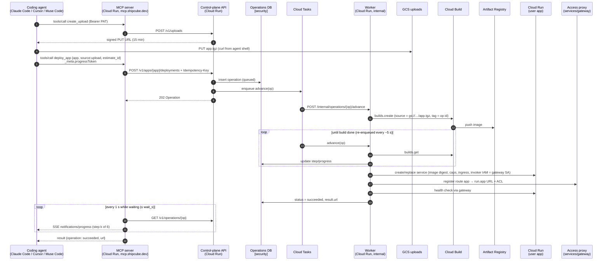
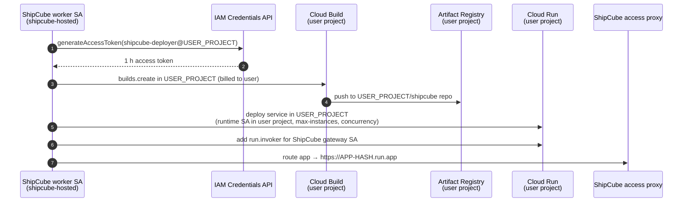

# Backend networking

**Workstream:** backend networking · **Owns:** this doc, `services/mcp/**`, `services/api/**` · **Status:** research done, stub servers running · **Researched:** Oct 27, 2026

This doc covers how a coding agent reaches ShipCube, how ShipCube reaches GCP, and how people reach the apps ShipCube deploys. Each section ends with a decision. Choices that depend on another workstream are marked **[security]** (Infra and security: identity, `services/gateway`, the database) or **[language]** (Go vs Python).

## TL;DR: decisions

| # | Topic | Decision for the 10-day build | Later |
|---|---|---|---|
| 1 | MCP transport | One remote **Streamable HTTP** endpoint, `https://mcp.shipcube.dev/mcp`, built on the stateless **2026-07-28** spec. No stdio package. | A stdio shim only if a client can't do remote HTTP |
| 1 | MCP auth | **Personal access token** (`sc_pat_…`) from the web console, sent as `Authorization: Bearer`. | **OAuth 2.1** per the MCP authorization spec: ShipCube as the authorization server in front of Google sign-in, Client ID Metadata Documents first, DCR as fallback |
| 2 | Tools | 17 tools (§2). Long-running tools return an **Operation**, wait up to `wait_s` (≤55 s) while streaming `notifications/progress`, then hand back the id for `get_operation`. **Idempotency keys** on every mutating call. | The MCP `tasks` extension, once Claude Code and Cursor support it |
| 3 | Control plane | **REST + JSON**, OpenAPI 3.1, `/v1` in the path, AIP-151-style operations. No gRPC. Deploys and profiling run as a **step machine driven by Cloud Tasks**. | Workflows if the step graph grows |
| 4 | Flow | MCP → API → Cloud Tasks → worker → Cloud Build → Artifact Registry → Cloud Run. In a linked project the worker impersonates a deployer service account there. | |
| 5 | Reaching apps | `https://<app>.apps.shipcube.dev` → global external ALB (wildcard cert) → **ShipCube access proxy** (`services/gateway`) → app's `run.app` URL using a service-to-service ID token. The app keeps the Cloud Run invoker IAM check. **[security]** | Direct IAP on Cloud Run as a no-domain fallback |
| 5 | Egress | Default: none. Apps that need a static IP for a customer database use Direct VPC egress + Cloud NAT with a reserved IP, one per GCP project. | |
| 6 | Caps | Cloud Run handles instances, concurrency, CPU/memory and timeout. The gateway handles requests per minute. Spend uses ShipCube's own cost meter plus a billing budget, and the kill switch is `max-instances=0`. | Cloud Armor per-app rules |
| 6 | Budget | About **$25–30/month** fixed (ALB plus NAT), so $300 lasts about 8 months with headroom for builds. GKE Autopilot is placement-only. | |

---

## 1. MCP transport and auth

### 1.1 The spec moved: 2026-07-28 is stateless

The current MCP revision ([2026-07-28 changelog](https://modelcontextprotocol.io/specification/2026-07-28/changelog)) changes how a remote server is built:

- **No sessions, no `initialize` handshake.** `Mcp-Session-Id` is gone. Every request carries its protocol version, client info and capabilities in `_meta`, and servers implement `server/discover`. Any instance can answer any request, so a plain Cloud Run service with no session affinity works.
- **No standalone GET stream and no SSE resumability.** A request gets either a JSON reply or an SSE stream scoped to that request. If the stream breaks, the request is lost and the client re-issues it with a new id ([Streamable HTTP](https://modelcontextprotocol.io/specification/2026-07-28/basic/transports/streamable-http)). **Consequence for us:** any tool that starts work must be idempotent, because a retry is indistinguishable from a new call (§2.3).
- **Server→client requests (elicitation, sampling) became Multi Round-Trip Requests.** The server returns `resultType: "input_required"` and the client retries with `inputResponses`. We don't need this for v1, but `delete_app` could use it for confirmation later.
- **Tasks moved to an extension** (`io.modelcontextprotocol/tasks`), with polling via `tasks/get`.
- **Required request headers** `MCP-Protocol-Version`, `Mcp-Method` and `Mcp-Name` mirror the body, so a gateway or load balancer can route or rate-limit by tool name without parsing JSON.
- The old HTTP+SSE transport and the Roots, Sampling and Logging features are **deprecated**.

Clients on 2025-era versions still work: the official TypeScript v2 SDK answers them statelessly from the same endpoint by default (`createMcpHandler`'s `legacy: 'stateless'`; see the [SDK README](https://www.npmjs.com/package/@modelcontextprotocol/server) and the [SDK beta announcement](https://blog.modelcontextprotocol.io/posts/sdk-betas-2026-07-28/)). Our stub was verified both ways: `claude mcp list` (Claude Code 2.1.308) connects to it, and the v2 client in `npm run smoke` lists and calls all the tools.

### 1.2 Streamable HTTP vs stdio

| | Streamable HTTP (remote) | stdio (local subprocess) |
|---|---|---|
| Install | One URL: `claude mcp add --transport http …` | Users need Node, Python or a binary, plus updates |
| Credentials | Bearer token or OAuth per request | Env vars on the user's machine. The spec says stdio servers **SHOULD NOT** use the OAuth flow and should read credentials from the environment ([Authorization](https://modelcontextprotocol.io/specification/latest/basic/authorization)). |
| Where work runs | Our Cloud Run, next to the API | The user's laptop, which would still call our API over HTTPS |
| Uploading local code | Needs a signed-URL upload (§2.2) | Could read files directly |
| Updates | Deploy once | Every user upgrades |
| Clients | Claude Code ([docs](https://code.claude.com/docs/en/mcp)) and Cursor ([docs](https://cursor.com/docs/context/mcp)) both support remote HTTP, headers and OAuth | Universal |

stdio's only real advantage is reading local files, and the `create_upload` + `curl` pattern in §2.2 covers that, since every coding agent has a shell. **Decision: remote Streamable HTTP only.** If a client (possibly Muse Code; see below) only speaks stdio, ship a ~30-line stdio→HTTP bridge, or point users at the community `mcp-remote` bridge. Don't build a second server.

**How clients connect:**

```bash
# Claude Code (scopes: local [default], project → .mcp.json, user)
claude mcp add --transport http shipcube https://mcp.shipcube.dev/mcp \
  --header "Authorization: Bearer $SHIPCUBE_TOKEN"
```

```jsonc
// .mcp.json (Claude Code, committed to the repo). ${VAR} expands at load time.
{ "mcpServers": { "shipcube": { "type": "http", "url": "https://mcp.shipcube.dev/mcp",
    "headers": { "Authorization": "Bearer ${SHIPCUBE_TOKEN}" } } } }

// .cursor/mcp.json (Cursor). Note the ${env:NAME} syntax.
{ "mcpServers": { "shipcube": { "url": "https://mcp.shipcube.dev/mcp",
    "headers": { "Authorization": "Bearer ${env:SHIPCUBE_TOKEN}" } } } }
```

Gotchas from the Claude Code docs:
- A `url` without `"type": "http"` is read as stdio and skipped.
- Claude Code expands its own credential variables (`ANTHROPIC_API_KEY`, cloud-provider tokens, `NPM_TOKEN`, …) to an empty string in remote headers. Use our own name, `SHIPCUBE_TOKEN`.
- If a static `Authorization` header is rejected, Claude Code **does not fall back to OAuth**. This matters for the migration in §1.4.

**Muse Code:** I found no public documentation of its MCP client. **Action:** test it against the stub on day 2. If it only does stdio, use the bridge. The web console's MCP setup guide (frontend) should show all three snippets.

### 1.3 Auth options

**A. MCP authorization spec (OAuth 2.1).** In the [current spec](https://modelcontextprotocol.io/specification/latest/basic/authorization):
- The MCP server is an OAuth **resource server**. It **must** publish Protected Resource Metadata ([RFC 9728](https://datatracker.ietf.org/doc/html/rfc9728)) and return `401` with `WWW-Authenticate: Bearer resource_metadata="…"`.
- The client discovers the authorization server (RFC 8414 or OIDC discovery), runs auth code + **PKCE**, sends `resource=` ([RFC 8707](https://www.rfc-editor.org/rfc/rfc8707.html)), and validates `iss` (RFC 9207).
- The server **must** check that the token's audience is itself, and must not pass tokens through.
- Client registration priority: **Client ID Metadata Documents** (the client's `client_id` is an HTTPS URL to its metadata), then pre-registration, then **Dynamic Client Registration**, which is now **deprecated** (kept for compatibility).
- Both Claude Code (`/mcp` or `claude mcp login`) and Cursor run this flow. Cursor's docs describe DCR plus PKCE as a public client.

What it costs us: **Google's OAuth server can't be the MCP authorization server.** It supports neither CIMD/DCR nor RFC 8707 audiences for our resource. So we would run our own authorization server (`/authorize`, `/token`, metadata, CIMD fetch with SSRF protection, refresh tokens, consent screen) that uses Google sign-in as the upstream identity provider. Alternatively we could rent one (Auth0, Stytch, WorkOS, Descope and Cloudflare all market MCP-ready authorization servers). Building it is 2–3 days of security-sensitive work, or a vendor dependency and possible cost.

**B. Personal access tokens (PATs).** The user signs in to the console with Google, clicks "Create token", and pastes the one-line `claude mcp add …` command, which the frontend can pre-fill. The MCP server reads `Authorization: Bearer sc_pat_<random>`, and the API looks up `sha256(token)` to get the user, workspace, scopes and expiry. That's about half a day of work. Every client supports static headers. Tokens are revocable, but long-lived bearer secrets sit on laptops.

**C. Google ID tokens directly:** rejected. The audience would be Google's client, not our MCP server, and the spec forbids accepting or passing through tokens issued for someone else.

### 1.4 Decision and migration path

**Phase 1 (hackathon): PATs.**
- Format: `sc_pat_` plus 32 random bytes in base62. The prefix makes them easy for secret scanners to find (GitHub secret scanning supports custom patterns). Store only the hash. Default expiry 30 days. Scopes: `apps:read`, `apps:write`, `data:query`.
- The MCP server never sees Google credentials. **[security]** owns the token table and how tokens are minted.
- The MCP server verifies tokens with the SDK's `verifyBearerToken` (already wired in `services/mcp/src/server.ts`; the stub accepts one dev token). The API re-checks the forwarded token, so the API is the only place that makes authorization decisions.

**Phase 2: OAuth 2.1, with PATs kept.**
1. Stand up an authorization server, built or rented, at `auth.shipcube.dev`, with Google as upstream IdP. Support CIMD, and DCR for older clients.
2. Serve `/.well-known/oauth-protected-resource` from the MCP server, listing that authorization server and `scopes_supported`.
3. Make the verifier accept **either** a PAT (prefix `sc_pat_`, hash lookup) **or** a JWT access token (signature, `aud == https://mcp.shipcube.dev/mcp`, expiry, scopes). The tools don't change: they read `authInfo` from the context either way.
4. Return the RFC 9728 challenge on `401` when no `Authorization` header is present. Clients configured with a PAT keep working. New users just run `claude mcp add --transport http shipcube https://mcp.shipcube.dev/mcp` and finish OAuth in the browser.
5. Because Claude Code doesn't fall back from a rejected header to OAuth, the setup guide tells PAT users to **remove** the header to switch.

The SDK's `scopeChallenge` hook on `registerTool` supports per-tool step-up later (for example, requiring `apps:delete` for `delete_app`).

### 1.5 Transport hardening

- **Origin and Host validation:** required by the spec, to stop DNS rebinding. Done with the SDK's `hostHeaderValidation` and `originValidation`. In production the allow-list is `mcp.shipcube.dev`.
- The server refuses to bind a non-loopback address without a token.
- TLS terminates at Cloud Run (`*.run.app`) or at the ALB if we put `mcp.shipcube.dev` behind it.
- Send `X-Accel-Buffering: no` on SSE responses (the spec recommends it).
- Set the Cloud Run request timeout to at least 60 s, so a `wait_s=55` call finishes.
- **Rate limits per token** at the MCP layer (e.g. 60 tool calls/min, and 10 deploys/hour per workspace) live in the API, not in the MCP server.

### 1.6 SDK and language choice **[language]**

The stub uses the **official TypeScript SDK v2** (`@modelcontextprotocol/server` 2.4.0, stable, implements 2026-07-28).

Why it was quickest to demo:
- Node 22 is already installed here. The system Python is 3.9, which is below what the `mcp` package needs, and Go isn't installed.
- The TS SDK is the reference implementation. Its v2 line is stable (released Oct 2026), while Go is at `v1.7.0-pre` for this spec.
- It ships `createMcpHandler`, legacy-client support, bearer-auth helpers and Host/Origin guards, which we would otherwise write ourselves.

**Keeping it swappable:** the MCP server is a stateless adapter. Its only dependency is the HTTP contract in `services/api/openapi.yaml`. The tool schemas are plain JSON Schema (Zod is just the authoring format), so a port to Python v2 (`MCPServer`, formerly FastMCP) or to Go is mechanical: same tool names, same schemas, same API calls. If the language research picks Python or Go for the control plane, `services/api/src` is the part to rewrite. I'd still keep the MCP adapter in TypeScript unless one-language-everywhere matters more, because it's about 500 lines with no business logic.

---

## 2. MCP tools

The draft in `docs/ARCHITECTURE.md` §0 had 11 tools. The final list has **17**. The additions:
- `create_upload`: the agent's code has to reach us somehow.
- `get_operation` / `cancel_operation`: long-running work.
- `whoami`: lets the agent pick a GCP target.
- `list_apps` and `delete_app`.

`get_status` also returns the access list, so there is no `list_access`. The source of truth is `services/mcp/src/tools.ts`, and every tool declares an `outputSchema` and returns `structuredContent`.

### 2.1 Tool list

| Tool | Input (required **bold**) | Output | Annotations |
|---|---|---|---|
| `whoami` | — | `user_id, email, workspace, gcp_targets[{id, project, kind: shipcube\|linked, default}], limits` | read-only |
| `create_upload` | `content_type` | `upload_id, method: PUT, url, headers, max_bytes, expires_at` | |
| `estimate_load` | **`source`**, `app`, `expected_users`, `schedule`, `wait_s` | `{operation, next?}`. When done, `operation.result` holds `estimate_id, workload_class, confidence, tier, target, resources, monthly_cost_usd{low, expected, high}, profile, recommended_caps, reasoning, alternatives[]` | read-only (no user-visible side effects) |
| `deploy_app` | **`app`**, **`source`**, `estimate_id`, `tier`, `target`, `region`, `env`, `secrets` (names only), `caps`, `idempotency_key`, `wait_s` | `{operation, next?}`. Result: `app, url, revision, tier, target, access` | idempotent |
| `get_operation` | **`id`**, `wait_s` | `{operation, next?}` | read-only |
| `cancel_operation` | **`id`** | `{operation}` | idempotent |
| `list_apps` | — | `apps[{name, url, tier, status, updated_at}]` | read-only |
| `get_status` | **`app`** | `name, url, tier, target, region, status, revision, image, caps, access[], ai, updated_at` | read-only |
| `get_logs` | **`app`**, `severity`, `limit`, `page_token` | `entries[{timestamp, severity, message, revision}], next_page_token` | read-only |
| `get_metrics` | **`app`**, `window` | requests, error rate, p50/p95, instances, cold starts, CPU/memory utilization, `cost_usd`, `caps_hit`, `data_freshness_minutes` | read-only |
| `set_caps` | **`app`**, **`caps`** | `caps, enforced_by{cap → mechanism}` | idempotent |
| `grant_access` | **`app`**, **`principal`** (`user:`/`group:`/`domain:`), `role` | `access[]` | idempotent |
| `revoke_access` | **`app`**, **`principal`** | `access[]` | destructive, idempotent |
| `connect_data` | **`name`**, **`kind`**, `connection_secret`, `model_yaml` | `datasource_id, egress` (the IP to allow-list), `cubes_detected, status` | open-world |
| `query` | **`query`** (the semantic L0/L1 shape from ARCHITECTURE §2), `datasource` | `level, sql, columns, rows, cached, verified` | read-only, open-world |
| `ai_config` | **`app`**, `provider`, `model`, `key_secret`, `base_url` | `ai, gateway_url` | idempotent |
| `delete_app` | **`app`**, **`confirm: true`**, `wait_s` | `{operation, next?}` | destructive |

Shared types:

```ts
Source = { kind: "upload", upload_id } | { kind: "git", url, ref?, subdir? }
       | { kind: "image", uri } | { kind: "inline", files: [{path, content}] /* ≤50 files, ≤256 KB */ }
Caps   = { max_instances?: 0..10, concurrency?: 1..1000, requests_per_minute?, monthly_spend_usd?,
           cpu?: "0.5"|"1"|"2"|"4", memory?: "512Mi", timeout_s?: 1..3600 }
Operation = { id, kind: estimate|deploy|delete, app, status: queued|running|succeeded|failed|cancelled,
              done, progress: {step, completed_steps, total_steps, message}, steps[{name, status}],
              result, error: {code, message} | null, poll_after_s, created_at, updated_at }
```

Rules for the schemas:
- **Secrets are never tool arguments.** `secrets`, `connection_secret` and `key_secret` are names of secrets the user stored through the console, so values never appear in agent transcripts. **[security]** owns the secret store.
- App names are DNS labels (`^[a-z][a-z0-9-]{1,38}[a-z0-9]$`), so `<app>.apps.shipcube.dev` and the Cloud Run service name are both valid.
- Tool descriptions spell out the normal flow (create_upload → estimate_load → deploy_app with `estimate_id` → grant_access), and the server `instructions` repeat it.

### 2.2 Getting code from the agent to ShipCube

`create_upload` returns a 15-minute **V4 signed URL** for a PUT to a private GCS bucket, scoped to one object and content type. The agent runs:

```bash
tar czf - --exclude .git --exclude node_modules . | curl -X PUT -H "Content-Type: application/gzip" --data-binary @- "$URL"
```

Then it passes `{kind: "upload", upload_id}`. This keeps large payloads out of JSON-RPC, and the agent's own shell does the upload. The other source kinds:
- `git`: public repos, or private ones through a GitHub App later.
- `image`: the user already built a container.
- `inline`: tiny single-file apps, so the demo works even without a shell.

### 2.3 Long-running operations

Profiling takes 10–60 s and a deploy takes 1–3 min (mostly Cloud Build). The constraints:
- Tool calls block the agent.
- Some clients enforce a per-call timeout.
- A broken stream drops the call (§1.1).
- Tasks-extension support in clients is unknown.

The design:

1. **Every long-running tool returns an Operation**, the same object the API returns (AIP-151 style). The agent sees `status`, `steps[]` and `progress`.
2. **Bounded wait.** The tool waits up to `wait_s` (default 20, max 55). Meanwhile it polls the API once a second and sends **`notifications/progress`** on that request's SSE stream whenever a step completes, if the client sent a `progressToken` ([progress spec](https://modelcontextprotocol.io/specification/2026-07-28/basic/patterns/progress)). Claude Code and the SDK client show these.
3. If the work isn't done when the wait ends, the result includes `next: "Call get_operation with id … to keep waiting"`. **Polling, not push notifications:** in 2026-07-28 there is no server-initiated channel for request results. `subscriptions/listen` covers only list and resource changes. And the agent is the one waiting anyway.
4. **Idempotency.**
   - `deploy_app` takes `idempotency_key`, which the MCP server sends as an `Idempotency-Key` header ([IETF draft](https://datatracker.ietf.org/doc/draft-ietf-httpapi-idempotency-key-header/)).
   - The API stores `key → (operation_id, request_hash)`. The same key with the same body returns the **same operation**. The same key with a different body returns `409`.
   - If the agent omits the key, the MCP server derives one from `hash(token, tool, args, 10-minute bucket)`, so a retry after a dropped stream doesn't start a second build.
   - The smoke test shows this: a second run got back the same estimate and deploy operation ids.
5. **Cancellation.** Closing the SSE stream cancels only the *wait* (the handler watches `ctx.mcpReq.signal`), never the deploy. `cancel_operation` is explicit.
6. **Later:** advertise the `io.modelcontextprotocol/tasks` extension, so capable clients get a task handle and use `tasks/get`. The Operation maps onto it 1:1.

---

## 3. Control-plane API

### 3.1 REST vs gRPC

| | REST + JSON (OpenAPI) | gRPC | Both |
|---|---|---|---|
| Clients | MCP server (JSON-RPC, so JSON is native), web console (browser `fetch`), curl | Browsers need gRPC-Web or Connect | Two surfaces to keep in sync |
| Cloud Run | Works | Works (HTTP/2 end-to-end, h2c) | |
| Tooling in 10 days | OpenAPI → TS/Go/Python types, Swagger UI for the demo | protoc toolchain in every language | |
| Streaming | SSE for logs | Native streams | |

**Decision: REST + JSON only.** Every caller already speaks JSON, the API is small, and Cloud Run's HTTP/2 makes gRPC's transport advantage irrelevant at our scale. Internal calls (worker ↔ API) go over the same REST API with service-account ID tokens. If we ever need typed internal RPC, use **Connect** on the same handlers, which serves JSON and gRPC from one definition, rather than adding a second API.

### 3.2 Conventions

- **Versioning:** `/v1` in the path. Additive changes don't bump it. A breaking change means `/v2` routes running alongside `/v1`. The MCP tool surface is versioned separately (tool names are the contract), and the MCP server pins the API version it calls.
- **Resources:** `/v1/apps/{app}`, `/v1/apps/{app}/deployments`, `/v1/operations/{id}`, `/v1/apps/{app}/access/{principal}`. See `services/api/openapi.yaml`.
- **Long-running operations:** `202 Accepted` + `Location: /v1/operations/{id}` + `Retry-After`. The body is the Operation.
- **Errors:** `{error: {code, message}}` with `code` drawn from `invalid_argument`, `unauthenticated`, `permission_denied`, `not_found`, `conflict`, `resource_exhausted` (cap hit) and `internal`. Mapped to the matching HTTP statuses.
- **Auth:** `Authorization: Bearer` with the user's PAT or OAuth token, forwarded by the MCP server. The console uses a session cookie that the API also accepts. **[security]**
- **Pagination:** `page_token` / `next_page_token`.

### 3.3 Job and queue model on GCP

Options for running "estimate" and "deploy":

| | Cloud Tasks | Pub/Sub | Workflows |
|---|---|---|---|
| Model | Queue of HTTP calls to a target you choose, with retries, rate limits and scheduled delivery | Fan-out event bus, push or pull | Managed state machine (YAML), with connectors that poll long-running GCP operations themselves |
| Fit | Dispatch "advance operation X" to our worker. Built-in per-queue rate limits and max concurrent dispatches double as a deploy throttle. | Receiving events: Cloud Build publishes status to the `cloud-builds` topic; budget alerts publish too | A deploy pipeline written as YAML, with a visible execution graph |
| Free tier | 1M operations/month ([pricing](https://cloud.google.com/tasks/pricing)) | 10 GiB/month ([pricing](https://cloud.google.com/pubsub/pricing)) | 5,000 internal + 2,000 external steps/month. Connector polling counts as steps ([pricing](https://cloud.google.com/workflows/pricing)) |
| Cost to us | Logic stays in our code, so it's testable locally | Ordering and dedup are ours to handle | A second language for the logic; harder to run locally |

**Decision: Cloud Tasks drives a step machine in our worker. Pub/Sub only for incoming GCP events.**

```
operations table:  id, kind, workspace, target_project, status, step, step_state(json), attempts, idem_key, request_hash
deploy steps:      validate → build → push → deploy → configure_access → health_check
estimate steps:    fetch_source → sandbox_profile → classify → reason(Muse Spark) → price
```

1. The API writes the operation row (`queued`) and enqueues a Cloud Task: `POST /internal/operations/{id}/advance` on the worker. The worker is a Cloud Run service; it could be the API service itself, on an internal-only route.
2. The worker loads the row, runs **one step**, saves the result and re-enqueues itself, with `scheduleTime` = now + poll interval while it waits on an external long-running operation.
   - `build` calls `projects.locations.builds.create`, which returns a long-running Operation holding the build id ([API](https://docs.cloud.google.com/build/docs/api/reference/rest/v1/projects.builds/create)). Later passes call `builds.get` until `SUCCESS` or `FAILURE`.
   - `deploy` calls the Cloud Run Admin API `services.replaceService`/`create` and polls its operation the same way.
3. Each step is **idempotent by construction**: deterministic names (`build tag = op id`, `revision suffix = op id`), check-before-create, and `step_state` saved before external calls. Cloud Tasks' at-least-once delivery and retries are therefore safe.
4. Cancellation sets `status=cancelled`. The next `advance` sees it, calls `builds.cancel` if a build is running, and stops.
5. The queue is configured with `maxConcurrentDispatches` (e.g. 5) and `maxDispatchesPerSecond`, which is a free global throttle on how fast we spend Cloud Build minutes.

Profiling (`sandbox_profile`) runs as a **Cloud Run job** execution: per-task timeout up to 168 h, and a job takes no inbound requests ([quotas](https://docs.cloud.google.com/run/quotas)). Sandbox hardening (no egress, a scoped runtime SA) is **[security]**'s call. The worker starts it and polls it the same way.

Why not Workflows: it does exactly this, but it puts the pipeline in YAML that we can't unit-test locally. Step-poll loops also burn internal steps. Moving to it later is easy because the steps are already discrete.

---

## 4. Request flow

### 4.1 Deploy into ShipCube's project



### 4.2 Deploy into a user's linked GCP project

The only differences are **where** Cloud Build, Artifact Registry and Cloud Run live, and **which identity** the worker uses. Linking (Google sign-in + consent, service-account setup) is **[security]**'s design. Networking assumes the result is a **deployer service account in the user's project** that ShipCube's worker SA may impersonate (`roles/iam.serviceAccountTokenCreator` on that SA).



Roles the deployer SA needs in the user's project:
- `roles/run.developer`, plus `roles/iam.serviceAccountUser` on the app's runtime SA ([Cloud Run deploy IAM](https://docs.cloud.google.com/run/docs/deploying)).
- `roles/cloudbuild.builds.editor`.
- `roles/artifactregistry.writer` on the `shipcube` repo.
- Cloud Build's own SA needs `run.admin`, SA User and AR Writer if it deploys itself ([Cloud Build → Cloud Run](https://docs.cloud.google.com/build/docs/deploying-builds/deploy-cloud-run)). We do the deploy from the worker instead, so Cloud Build only builds.

Builds are charged to the project that runs them ([Cloud Build pricing](https://cloud.google.com/build/pricing)), so linked users spend their own 2,500 free build-minutes.

Keeping the **image in the user's project** avoids cross-project pulls. Pulling from ShipCube's registry would need the Cloud Run service agent of *their* project granted read access to *our* registry.

**Networking consequence:** apps in a linked project still sit behind **ShipCube's** access proxy, so URLs, access control and rate caps work identically. The proxy calls the app's `run.app` URL with an ID token minted for its own SA, which the user's service accepts because of the invoker binding. The user's app can't be private-ingress (`internal`), because that needs a VPC path from our project. It stays IAM-protected instead (§5.3).

---

## 5. Reaching user apps

### 5.1 URLs

| Option | Wildcard? | Per-app setup | Cost | Notes |
|---|---|---|---|---|
| Raw `https://<svc>-<hash>.<region>.run.app` | n/a | none | $0 | Ugly, leaks the project hash, different per project |
| Cloud Run **domain mappings** | **No** | One mapping + certificate per app, takes minutes | $0 | Still **Preview** and "not recommended for production" (latency), in 10 regions only ([docs](https://docs.cloud.google.com/run/docs/mapping-custom-domains)) |
| Firebase Hosting rewrite | Per site | Config per app | Free tier | **60 s request timeout**, which breaks SSE and WebSockets ([docs](https://firebase.google.com/docs/hosting/cloud-run)) |
| **Global external ALB + wildcard cert** | **Yes** (`*.apps.shipcube.dev`, one level) | None. One DNS record and one cert for all apps | ~$18/month for the forwarding rule + $0.008/GiB ([pricing](https://cloud.google.com/load-balancing/pricing)) | Wildcard certs need Certificate Manager **DNS authorization** ([docs](https://docs.cloud.google.com/certificate-manager/docs/domain-authorization)) |

A serverless NEG can route with a **URL mask** (e.g. `<service>.example.com`) straight to many Cloud Run services ([serverless NEG concepts](https://docs.cloud.google.com/load-balancing/docs/negs/serverless-neg-concepts)). But a NEG can only target services in **its own project and region**, so masks can't reach apps in linked projects. That's one reason the ALB routes everything to our access proxy instead.

**Decision:** `https://<app>.apps.shipcube.dev` → ALB (wildcard cert) → one backend: the **access proxy**. Apps in ShipCube's project and in linked projects get the same URL scheme. A second host, `<app>--<workspace>.apps…`, is reserved for multi-tenant name clashes. *(Needs a real domain; see the open questions.)*

### 5.2 Access control: IAP vs our own proxy **[security]**

**Direct IAP on Cloud Run** has been GA since March 2026: no load balancer, no added cost. Enable it with `gcloud run deploy --iap`, then grant users `roles/iap.httpsResourceAccessor` ([announcement](https://cloud.google.com/blog/products/serverless/iap-integration-with-cloud-run), [docs](https://docs.cloud.google.com/run/docs/securing/identity-aware-proxy-cloud-run)).

| | Direct IAP on each app | ShipCube access proxy (`services/gateway`) |
|---|---|---|
| Cost | $0 | Shares the ALB (~$18/month) + one small Cloud Run service |
| URLs | Only `run.app` (IAP can't be on both the ALB and the service) | `<app>.apps.shipcube.dev` |
| Grants | IAM bindings in the **app's project**. In linked projects that means writing IAM in the user's project for every share. | One ACL table in ShipCube, the same for every target |
| Identity | Google accounts. Users outside an org need a custom OAuth client with an external brand. | Google sign-in via ShipCube, the same identity as the console |
| Rate caps / AI gateway / metering | No | Yes: one hop where we can count requests, enforce `requests_per_minute` and inject `X-ShipCube-User` |
| Effort | Small | Medium: OIDC login, sessions, a streaming reverse proxy |

**Recommendation: build the access proxy.** Caps (§6), per-app usage metering for monitoring and identical behavior in linked projects all need one ShipCube-controlled hop, and IAP gives none of them. Keep **direct IAP as the fallback** if the proxy slips: `deploy_app` can set `--iap` and return the `run.app` URL, and `grant_access` becomes an IAM binding.

What networking needs from the gateway design (proposed to **[security]**):
1. **Routing:** look up `Host` → `{app, target_url (run.app), acl_version}` from the API, cached for 30 s.
2. **AuthN:**
   - Browser: the OIDC login runs at `auth.shipcube.dev`, which then hands the session to the app's host. The gateway sets a **host-only** session cookie on `<app>.apps.shipcube.dev`. **Never** set a cookie on `.apps.shipcube.dev`: every app is user code on a sibling subdomain and would receive it.
   - Programmatic callers: `Authorization: Bearer` with a PAT scoped to that app.
   - Longer term, submit `apps.shipcube.dev` to the **Public Suffix List** so browsers isolate sibling apps.
3. **Strip** ShipCube's cookies and `Authorization` before proxying. Add `X-ShipCube-User` (email) and a signed `X-ShipCube-Assertion` (a JWT the app can verify, like IAP's `x-goog-iap-jwt-assertion`).
4. **Upstream auth:** fetch a Google **ID token** for audience = the app's `run.app` URL from the metadata server, cached about 55 min, and send it as `Authorization`. The app stays `--no-allow-unauthenticated`, with invoker IAM granted only to the gateway SA (and the owner, for debugging).

### 5.3 Ingress settings

Ingress options are `all`, `internal` and `internal-and-cloud-load-balancing` ([docs](https://docs.cloud.google.com/run/docs/securing/ingress)).
- `internal-and-cloud-load-balancing` would only help if the ALB pointed at the apps directly. Ours points at the gateway, which is a Cloud Run → Cloud Run hop.
- `internal` would require the gateway to send egress through a VPC and only works within one project's network, so it fails for linked projects.

**Decision:** apps use `ingress=all` plus the **invoker IAM check** (unauthenticated requests are rejected by Google's front end before reaching the container). The gateway itself uses `internal-and-cloud-load-balancing`, so it is reachable only through the ALB. The MCP server and API use `all` (MCP clients call them directly), with the API's internal routes checked against Cloud Tasks' OIDC token.

### 5.4 WebSockets and SSE

- Cloud Run supports both. Both are bounded by the **request timeout**: default 5 min, max **60 min**, and Google advises tolerating reconnects past 15 min ([timeout](https://docs.cloud.google.com/run/docs/configuring/request-timeout), [WebSockets](https://docs.cloud.google.com/run/docs/triggering/websockets)).
- Session affinity is best-effort, so apps must not keep per-socket state that can't be rebuilt.
- Don't enable end-to-end HTTP/2 for WebSocket services.

For the gateway, this means:
- Proxy `Upgrade` and stream responses without buffering. Set `X-Accel-Buffering: no` and flush per chunk.
- Gateway timeout ≥ app timeout. Set the ALB backend timeout to 3,600 s for the gateway backend.
- The ALB proxies WebSockets natively, so the ALB → gateway → app chain works.
- Logs in the console stream over SSE from the API, which is the same pattern.
- The ALB's own MCP endpoint (if `mcp.shipcube.dev` sits behind it) needs a timeout ≥ 60 s.

### 5.5 Egress to user databases

Most demo apps read BigQuery or DuckDB, which needs no network setup. For customer Postgres/Snowflake behind an IP allow-list:
- **Direct VPC egress** (GA, recommended, no connector VMs, scales to zero) with all traffic routed to the VPC, plus **Cloud NAT** in manual mode with a **reserved static IP** ([static outbound IP](https://docs.cloud.google.com/run/docs/configuring/static-outbound-ip), [VPC options](https://docs.cloud.google.com/run/docs/configuring/connecting-vpc)).
- Cost: NAT IP $0.005/h (~$3.60/month) + $0.045/GiB processed + the gateway-hour charge ([NAT pricing](https://cloud.google.com/nat/pricing)). Serverless Access connectors are billed as VMs, so avoid them.
- One NAT per project and region. Every app in ShipCube's project that opts in shares **one** egress IP, which `connect_data` returns so the user can allow-list it. Linked projects get their own NAT, created on first `connect_data`.
- Only apps with `egress: static` get `--network/--subnet --vpc-egress=all-traffic`. Everything else keeps default internet egress (no NAT charges).
- Private-IP databases (Cloud SQL in the user's VPC) work through the same Direct VPC egress in the linked project.
- Risk to note: the IP is shared across tenants on ShipCube's project, so allow-listing it lets in every ShipCube app with static egress. Customers who care should use a linked project. **[security]**

---

## 6. Caps at the network layer, and cost

### 6.1 Where each cap is enforced

| Cap | Mechanism | Notes |
|---|---|---|
| `max_instances` | Cloud Run `--max-instances` (default 100; we default to **2**, max 10) ([docs](https://docs.cloud.google.com/run/docs/configuring/max-instances)) | Hard ceiling on compute cost. Excess requests queue, then get `429`. |
| `concurrency` | Cloud Run `--concurrency` (≤1000; gcloud default 80×vCPU) ([docs](https://docs.cloud.google.com/run/docs/about-concurrency)) | |
| `cpu`, `memory`, `timeout_s` | Cloud Run resource limits and request timeout | Request-based billing for T1 (CPU only during requests) ([billing modes](https://docs.cloud.google.com/run/docs/configuring/billing-settings)) |
| `requests_per_minute` | **Gateway token bucket** keyed by `(app)` and `(app, principal)` | In-memory per gateway instance with the gateway capped at 1–2 instances, so it's approximate but free. Later: Cloud Armor per-host rate-limit rules on the ALB (~$5/policy + $1/rule/month; thresholds apply per backend service) ([rate limiting](https://docs.cloud.google.com/armor/docs/rate-limiting-overview), [pricing](https://cloud.google.com/armor/pricing)). Mirrored MCP headers (`Mcp-Name`) let the same component rate-limit MCP tools. |
| `monthly_spend_usd` | ShipCube **cost meter** (instance-seconds and requests from Cloud Monitoring × list price, plus AI gateway tokens) checked every 5 min. Over cap → `max-instances=0` (app returns 429/503 via gateway with a "cap reached" page) and an alert. Backstop: a **Cloud Billing budget** with Pub/Sub notifications on the project. | Billing export lags by hours, so our own meter is the primary signal. |
| Deploys and builds | Cloud Tasks queue `maxConcurrentDispatches` + per-workspace quota in the API (e.g. 20 deploys/day) | Protects the free 2,500 build-minutes |
| T2 jobs | Cloud Run job `--task-timeout`, `--max-retries`, `--parallelism`; Cloud Scheduler frequency floor (≥15 min) | |
| AI tokens | AI gateway per-app budget | Owned with `packages/providers` |

### 6.2 Budget on $300 (ShipCube's project, us-central1)

Fixed monthly costs:

| Item | $/month | Source |
|---|---|---|
| Global ALB forwarding rule (`*.apps` + `mcp`/`api` on one rule via host routing) | ~18.00 | [LB pricing](https://cloud.google.com/load-balancing/pricing) |
| Cloud NAT static IP (only once a demo app needs static egress) | ~3.60 + data | [NAT pricing](https://cloud.google.com/nat/pricing) |
| Reserved global IP for the ALB | 0 (free while attached) | [IP pricing](https://cloud.google.com/vpc/network-pricing) |
| Certificate Manager (1 wildcard cert) | ~0 (first certs free; **unverified**) | |
| Cloud Run: MCP, API, worker, gateway at min-instances 0 | ~0 within free tier (180k vCPU-s, 360k GiB-s, 2M requests) | [Run pricing](https://cloud.google.com/run/pricing) |
| Database **[security]**: Firestore free tier vs Cloud SQL db-f1-micro | 0 vs ~7.70 | [Firestore](https://cloud.google.com/firestore/pricing), [Cloud SQL](https://cloud.google.com/sql/pricing) |
| Cloud Tasks, Pub/Sub, Scheduler (3 jobs), Secret Manager (6 versions), Logging (50 GiB) | ~0 (free tiers) | linked pricing pages above |
| **Fixed total** | **≈ $22–30** | |

Variable costs:
- Cloud Build: 2,500 free minutes/month, then $0.006/min on e2-standard-2.
- Artifact Registry: 0.5 GiB free, then ~$0.10/GiB-month. Keep only the last 3 images per app with a cleanup policy.
- App compute: about $0.000024/vCPU-s. One demo dashboard serving 1,000 requests/day at 200 ms ≈ 6,000 vCPU-s/month, inside the free tier.

Excluded:
- **GKE Autopilot:** the $0.10/h cluster fee is covered for one cluster by the $74.40/month free-tier credit, but pods are billed per resource ([GKE pricing](https://cloud.google.com/kubernetes-engine/pricing)). T3/T4 stay placement-only, as ARCHITECTURE §4 says.
- Cloud Armor (~$6+/month) is off until needed.

**Result:** about $30/month fixed, so $300 covers the hackathon several times over. The real risk is a runaway app or build loop, which the caps above bound.

Guardrails on ShipCube's project:
- A billing budget at $25/$50/$100 with email alerts.
- Workspace defaults: `max_instances=2`, `monthly_spend_usd=5`, 5 apps, 20 deploys/day.
- No min-instances on the shared tier.

---

## Open questions

1. **Domain.** `shipcube.dev` is a placeholder. A real domain (~$12/year) is needed before the ALB, wildcard cert and OAuth redirect URIs exist. Until then, demo with `run.app` URLs and direct IAP (§5.2 fallback). Who buys it, and which name?
2. **Muse Code MCP support** (remote HTTP? headers? OAuth?) is undocumented publicly. Test it on day 2.
3. **[security]** Gateway session design (§5.2 items 2–4), the PAT table, the linked-project deployer SA and roles (§4.2), and the shared static egress IP risk (§5.5).
4. **[language]** If the control plane goes Go or Python, rewrite `services/api/src` against `openapi.yaml`. The MCP adapter can stay TypeScript.

## Sources

MCP: [Specification 2026-07-28 changelog](https://modelcontextprotocol.io/specification/2026-07-28/changelog) · [Streamable HTTP](https://modelcontextprotocol.io/specification/2026-07-28/basic/transports/streamable-http) · [Authorization](https://modelcontextprotocol.io/specification/latest/basic/authorization) · [Progress](https://modelcontextprotocol.io/specification/2026-07-28/basic/patterns/progress) · [SDK betas for 2026-07-28](https://blog.modelcontextprotocol.io/posts/sdk-betas-2026-07-28/) · [`@modelcontextprotocol/server` v2](https://www.npmjs.com/package/@modelcontextprotocol/server) · [Claude Code MCP docs](https://code.claude.com/docs/en/mcp) · [Cursor MCP docs](https://cursor.com/docs/context/mcp) · RFCs [9728](https://datatracker.ietf.org/doc/html/rfc9728), [8707](https://www.rfc-editor.org/rfc/rfc8707.html), [7591](https://datatracker.ietf.org/doc/html/rfc7591), [Idempotency-Key draft](https://datatracker.ietf.org/doc/draft-ietf-httpapi-idempotency-key-header/) · [AIP-151 long-running operations](https://google.aip.dev/151)

GCP (read Oct 27, 2026): [Cloud Run domain mappings](https://docs.cloud.google.com/run/docs/mapping-custom-domains) · [Serverless NEGs](https://docs.cloud.google.com/load-balancing/docs/negs/serverless-neg-concepts) · [HTTPS LB for serverless](https://docs.cloud.google.com/load-balancing/docs/https/setting-up-https-serverless) · [Certificate Manager domain authorization](https://docs.cloud.google.com/certificate-manager/docs/domain-authorization) · [IAP for Cloud Run (GA)](https://cloud.google.com/blog/products/serverless/iap-integration-with-cloud-run) · [IAP on Cloud Run docs](https://docs.cloud.google.com/run/docs/securing/identity-aware-proxy-cloud-run) · [IAP pricing](https://cloud.google.com/iap/pricing) · [Ingress](https://docs.cloud.google.com/run/docs/securing/ingress) · [Invoker access](https://docs.cloud.google.com/run/docs/securing/managing-access) · [Request timeout](https://docs.cloud.google.com/run/docs/configuring/request-timeout) · [WebSockets](https://docs.cloud.google.com/run/docs/triggering/websockets) · [VPC egress](https://docs.cloud.google.com/run/docs/configuring/connecting-vpc) · [Static outbound IP](https://docs.cloud.google.com/run/docs/configuring/static-outbound-ip) · [Concurrency](https://docs.cloud.google.com/run/docs/about-concurrency) · [Max instances](https://docs.cloud.google.com/run/docs/configuring/max-instances) · [Quotas](https://docs.cloud.google.com/run/quotas) · [Billing settings](https://docs.cloud.google.com/run/docs/configuring/billing-settings) · [Cloud Armor overview](https://docs.cloud.google.com/armor/docs/security-policy-overview) · [Cloud Armor rate limiting](https://docs.cloud.google.com/armor/docs/rate-limiting-overview) · [Deploying to Cloud Run (IAM)](https://docs.cloud.google.com/run/docs/deploying) · [Cloud Build → Cloud Run](https://docs.cloud.google.com/build/docs/deploying-builds/deploy-cloud-run) · [SA impersonation](https://docs.cloud.google.com/iam/docs/service-account-impersonation) · [Cloud Build builds.create](https://docs.cloud.google.com/build/docs/api/reference/rest/v1/projects.builds/create) · Pricing: [Cloud Run](https://cloud.google.com/run/pricing), [Load Balancing](https://cloud.google.com/load-balancing/pricing), [Cloud NAT](https://cloud.google.com/nat/pricing), [Network/IP](https://cloud.google.com/vpc/network-pricing), [Cloud Armor](https://cloud.google.com/armor/pricing), [Cloud Build](https://cloud.google.com/build/pricing), [Artifact Registry](https://cloud.google.com/artifact-registry/pricing), [Cloud Tasks](https://cloud.google.com/tasks/pricing), [Pub/Sub](https://cloud.google.com/pubsub/pricing), [Workflows](https://cloud.google.com/workflows/pricing), [Scheduler](https://cloud.google.com/scheduler/pricing), [Secret Manager](https://cloud.google.com/secret-manager/pricing), [Cloud SQL](https://cloud.google.com/sql/pricing), [Firestore](https://cloud.google.com/firestore/pricing), [Logging](https://cloud.google.com/stackdriver/pricing), [GKE](https://cloud.google.com/kubernetes-engine/pricing) · [Firebase Hosting + Cloud Run](https://firebase.google.com/docs/hosting/cloud-run)
